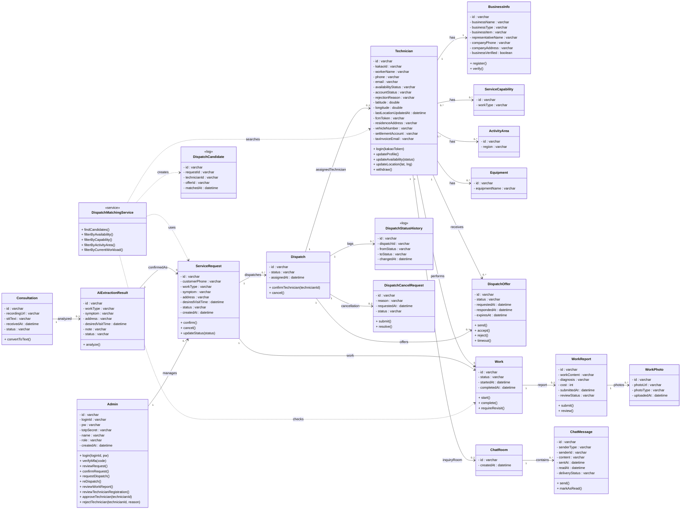

# 클래스 다이어그램 (초안 세팅)

> 이 파일은 mermaid `classDiagram` 문법으로 작성된 스캐폴드입니다.
> VS Code에서 "Markdown Preview Mermaid Support" 확장을 설치하면 `Ctrl+Shift+V`로 바로 미리보기가 가능하고,
> https://mermaid.live 에 코드 블록 내용을 붙여넣어도 동일하게 렌더링됩니다.
> 속성/오퍼레이션은 팀 논의하며 `// TODO` 부분을 채워 넣으세요.

# AI 긴급설비 자동접수·배차 시스템 클래스 다이어그램

# 대화 기반 변경 이력 (2026-09-29)

> 팀 논의(아래 "클래스 다이어그램 수정 필요 사항" 1~12번)와 별개로, 대화를 통해 클래스 단위로 구체화·수정된 내용을 모아 정리했습니다. 이유(왜 그렇게 결정했는지)를 같이 남겨서 나중에 왜 이런 구조인지 다시 물어볼 필요 없게 했습니다.

## Technician

- **CRUD 제거 및 구체적 행위로 대체**: `create/read/update/delete` → `login()`, `registerBusinessInfo()`, `updateProfile()`, `updateAvailability()`, `updateLocation()`, `withdraw()`로 교체.
  - *이유*: `create()`는 `registerBusinessInfo()`와 의미가 중복되어 제거. `delete()`는 "계정 탈퇴"(`withdraw()`)와 "프로필 필드 수정/비우기"(`updateProfile()`)를 구분해야 하는데, 필드를 지우는 것은 레코드 삭제가 아니라 값 변경이므로 `update` 계열로 흡수.
- **`registerBusinessInfo()` 앞에 `verifyBusiness()` 배치**: 사업자등록번호를 먼저 검증한 뒤 나머지 정보를 저장하도록 순서 변경.
  - *이유*: 회원가입 시 아이디 중복확인처럼, 유효하지 않은 사업자번호인데 다른 정보까지 다 입력받는 낭비를 막기 위함.
- **`fcmToken : varchar` 추가**.
  - *이유*: 배차 알림을 "전체 방송 후 앱에서 필터링" 방식이 아니라 **선별된 기사에게만 개별 타겟팅**(FR-07)하기로 결정했고, 이를 위해서는 기사 단말의 FCM 디바이스 토큰을 서버가 알고 있어야 함.
- **"로그인 여부"는 속성으로 두지 않음**.
  - *이유*: JWT Stateless 인증 구조에서 로그인 상태는 서버가 저장하는 값이 아니라 매 요청마다 토큰 유효성으로 판단하는 것이라, `isLoggedIn` 같은 필드를 두면 stateless 원칙과 모순됨.

## BusinessInfo / ServiceCapability / ActivityArea (신설)

- `Technician`에서 사업자정보·전문분야·활동지역을 분리.
  - *이유*: 기사 한 명이 **여러 전문분야·여러 활동지역**을 가질 수 있는데 `specialty`, `activityArea`를 단일 varchar로 두면 값을 쉼표로 이어붙이는 식의 편법이 필요하고, 개별 값 추가/삭제나 "이 분야를 가진 기사 찾기" 같은 조회가 비효율적이 됨.
- `registerBusinessInfo()`가 다루던 사업자 데이터가 옮겨간 것에 맞춰 `BusinessInfo.register()`/`verify()`로 재배치.

## ServiceRequest (구 Request)

- 이름 변경(`Request` → `ServiceRequest`) 및 `customerPhone` 추가.
  - *이유*: `Request`는 HTTP Request 등과 이름이 겹쳐 혼동 소지. 별도 `Customer` 클래스를 두지 않기로 했으므로 고객 연락처를 의뢰 자체가 들고 있어야 함.
- `confirm()`/`cancel()`은 **관리자가 의뢰 전체 단위**로 내리는 결정이고, `Dispatch.accept()`/`reject()`는 **기사 개인이 배차 1건에 대해** 내리는 응답이라는 점을 구분해서 유지.

## DispatchMatchingService

- `searchRadius`, `maxCandidates`, `calculateEta()`, `rankCandidates()`, `expandSearchRadius()` 제거.
  - *이유*: 거리순 우선순위/반경 확대는 요구사항 문서(FR-05)에 **"향후" 고도화 가능하도록 데이터만 축적**한다고 되어 있을 뿐 현재 확정 범위가 아님. 확정된 요구사항(작업유형·전문분야·작업가능상태·활동지역·위치 기반 후보 선별) 수준의 메서드만 유지.
- `findCandidates()`, `filterByAvailability()`, `filterByCapability()`, `filterByActivityArea()`, `filterByCurrentWorkload()` 유지/추가.
  - *`filterByCurrentWorkload()`를 추가한 이유*는 아래 Work 항목 참고.
- **향후 확장 메모**: 배차 정책이 구체화되면 AI/데이터 기반 매칭 스코어링, 최단 경로 계산 엔진(ETA) 등이 이 서비스에 추가될 수 있음 — 이 경우 `DispatchCandidate` 로그에도 계산 근거(`distance`, `eta` 등)를 다시 넣는 방향으로 검토.

## DispatchCandidate

- `<<log>>` 스테레오타입 부여, `distance`/`eta`/`priority`/`status` 제거, `requestId`/`technicianId`/`offerId`를 관계선이 아닌 **ID 속성**으로 저장.
  - *이유 1 (속성 제거)*: 위 알고리즘 미확정 사유와 동일 — 계산하지도 않는 값을 로그에 남길 수 없음. 특히 `status`를 "대기/휴식" 의미로 쓰면 `filterByAvailability()`가 이미 대기 상태만 후보로 만들기 때문에 값이 항상 고정되어 의미가 없고, 이후 기사가 상태를 바꾸면 로그값과 실제값이 어긋나는 정합성 문제도 생김.
  - *이유 2 (ID 속성)*: 로그는 특정 시점의 사실을 남기는 **불변 스냅샷**이어야 하는데, 살아있는 객체를 관계선으로 참조하면 나중에 그 객체(예: 탈퇴한 기사)가 바뀌거나 사라져도 로그가 영향을 받을 수 있음. ID 값만 복사해두면 원본이 바뀌어도 "그 당시 사실"이 그대로 보존됨.
  - CRUD 전부 제거: 로그는 한 번 쓰이고 다시 수정·삭제되지 않으므로.

## Dispatch / DispatchOffer (분리)

- 기존 `Dispatch` 하나가 담당하던 "기사에게 보내는 개별 요청"과 "최종 확정 결과"를 분리.
  - *이유*: 의뢰 하나를 여러 기사에게 동시에 보낼 경우 기사마다 응답(수락/거절/무응답)이 다를 수 있는데, 하나의 클래스로 관리하면 "누가 최종 담당자인지"와 "누가 어떻게 응답했는지"가 뒤섞임.
  - `Dispatch`: 의뢰의 배차 과정 전체와 최종 결과 관리 (`confirmTechnician()`, `cancel()`).
  - `DispatchOffer`: 기사 1명에게 전달된 개별 요청 1건 (`send()`, `accept()`, `reject()`, `timeout()`).
- `DispatchOffer.expiresAt` 추가.
  - *이유*: "배차 요청 유효시간이 만료된 경우 수락 불가"(FR-08 예외흐름)를 판단하려면 만료 시점 값이 필요.
- **Push/Pull 통합**: 시스템이 먼저 요청을 보내는 방식(Push, `DispatchOffer` 경유)과 기사가 미배정 목록에서 직접 고르는 방식(Pull) 모두 최종적으로 `Dispatch.confirmTechnician()`을 거치도록 설계.
  - *이유*: 두 경로 모두 "동일 의뢰에 한 명의 기사만 최종 배정"이라는 규칙을 어겨선 안 되므로, 확정 로직을 한 곳(`Dispatch`)에만 두어야 동시 수락 같은 예외 상황도 일관되게 처리 가능.
- `Dispatch "1" --> "0..1" Technician : assignedTechnician` 관계 추가.
  - *이유*: 원래는 "이 배차의 담당 기사가 누구인지" 알려면 여러 `DispatchOffer` 중 `accepted`인 것을 찾아야 하는 간접 구조였음. 자주 조회되는 정보를 매번 역추적하게 두는 대신 `Dispatch`가 직접 참조를 들고 있도록 함.

## Work (신설, 보류 후 결정)

- `ServiceRequest`가 의뢰 상태와 현장 작업 진행 상태(작업 시작/완료)를 모두 갖고 있던 것을 분리해 `Work` 클래스로 이동 (`start()`, `complete()`, `requireRevisit()`).
  - *이유*: 의뢰/배차 상태와 실제 현장 작업 상태는 서로 다른 생명주기를 가짐.
- 상태값 명칭을 `배정됨/진행중/완료/재방문필요`로 정함 — "대기"라는 단어를 쓰지 않음.
  - *이유*: `Technician.availabilityStatus`의 "대기"와 이름이 겹치면 두 개념(기사가 새 일을 받을 준비가 됐는가 vs 이 작업 건이 아직 시작 전인가)이 혼동될 수 있어서 명시적으로 구분.
- **작업중인 기사는 신규 배차 후보에서 자동 제외**하기로 결정했지만, 이를 위해 `Technician`에 별도 속성(`isBusy` 등)을 추가하지 않고 `DispatchMatchingService.filterByCurrentWorkload()`가 `Technician → Work` 관계를 조회해서 판단하도록 함.
  - *이유*: "작업중" 상태를 `Technician`과 `Work` 두 곳에 중복 저장하면 기사가 작업을 시작/종료할 때마다 두 값을 동기화해야 하고, 하나라도 놓치면 정합성이 깨짐 — `DispatchCandidate.status`에서 겪었던 것과 동일한 문제라 같은 원칙(사실의 원천은 하나로 유지)을 적용.

## WorkReport / WorkPhoto

- `beforePhotoUrls`/`afterPhotoUrls`(varchar)를 `WorkPhoto` 클래스로 분리 (`WorkReport "1" --> "0..*" WorkPhoto`).
  - *이유*: 작업 전/후 사진은 각각 여러 장 등록될 수 있는데 varchar 하나로는 여러 장을 제대로 표현·관리하기 어려움.

## ChatRoom / ChatMessage

- `ServiceRequest → ChatRoom` 관계 삭제, `Technician "1" --> "0..1" ChatRoom`으로 변경.
  - *이유*: 요구사항은 **의뢰별 채팅방**이 아니라 **기사별로 지속되는 1:1 채팅방**. 0..1로 둬서 문의가 없던 기사는 채팅방이 아예 없을 수 있게(지연 생성) 표현.
- `Admin "1" --> "0..*" ChatRoom : participates` 관계 제거, `Admin`에 `role : varchar`(MASTER/SUB) 추가, `ChatMessage`에 `senderId : varchar` 추가.
  - *이유*: 관리자 구조가 마스터/부 관리자로 나뉘고 **모든 관리자가 모든 채팅방에 응답 가능**하기로 결정. 채팅방을 특정 관리자 인스턴스 하나에 묶으면 이 요구사항과 모순되므로 관계 자체를 제거하고, 대신 여러 관리자가 한 방에서 메시지를 보낼 수 있으니 메시지 단위로 발신자를 구분할 `senderId`를 추가.

## Consultation / AiExtractionResult

- CRUD 제거, `convertToText()` / `analyze()`만 남김.
  - *이유*: 10번 원칙(단순 CRUD 제거)과 동일. 다만 `AiExtractionResult`에서 "관리자가 잘못된 정보를 수정"하는 행위(FR-04)를 표현할 메서드가 사라진 점은 아직 미해결 — `Admin.reviewRequest()`가 포괄하는 것으로 볼지, `AiExtractionResult.correct()`를 별도로 둘지 추가 논의 필요.

## Technician / Equipment (2026-09-30 반영)

- UC-09(기사 회원가입) 기본 흐름에 회원가입 시 입력받는 정보로 `세금계산서, 정산계좌, 기사 거주지, 보유장비, 차량번호`가 추가됨에 따라 클래스 다이어그램에도 반영.
- `Technician`에 `residenceAddress`, `vehicleNumber`, `settlementAccount`, `taxInvoiceEmail` 추가.
  - *이유*: 정산계좌·세금계산서 발행 이메일 모두 사업자(법인) 단위가 아니라 **기사 개인 명의**로 처리하기로 결정 → `BusinessInfo`가 아닌 `Technician`에 귀속. 거주지·차량번호도 기사 개인 정보이므로 동일하게 `Technician`에 귀속.
  - 거주지(`residenceAddress`)는 실제 거주 주소, `ActivityArea`는 영업(활동) 지역으로 서로 다른 개념이라 별도 유지.
- `Equipment` 클래스 신설, `Technician "1" --> "0..*" Equipment` 관계 추가.
  - *이유*: 기사 1명이 보유 장비를 여러 개 가질 수 있어 `ServiceCapability`/`ActivityArea`와 동일하게 다중값을 varchar 하나로 뭉쳐 넣는 편법을 피하기 위해 별도 클래스로 분리.

## Technician / Admin — 가입 승인 상태 추가 (2026-09-30 반영)

- `Technician`에 `approvalStatus : varchar`(승인대기/활성/반려), `rejectionReason : varchar` 추가.
  - *이유*: UC-06(기사 회원정보 검토 및 가입 승인), UC-09(기사 회원가입 및 로그인) 모두 기사 계정이 "승인대기 → 활성" 또는 "승인대기 → 반려" 상태를 거친다고 명시하는데, 기존 `Technician`에는 이 상태를 담을 필드가 없었음. `availabilityStatus`(대기/휴식)는 활성화된 기사가 새 일을 받을 수 있는지를 나타내는 별개 축이라 이름과 값 모두 구분.
  - `rejectionReason`은 UC-06 대안흐름(A2, 반려 사유 통보)을 위해 필요.
- `Admin`에 `reviewTechnicianRegistration()`, `approveTechnician(technicianId)`, `rejectTechnician(technicianId, reason)` 추가.
  - *이유*: UC-06이 관리자 유스케이스로 별도 식별되어 있는데, 기존 `Admin`의 오퍼레이션(`reviewRequest`, `confirmRequest` 등)은 모두 "의뢰(ServiceRequest)" 검토용이라 기사 가입 승인 행위를 표현할 메서드가 없었음.
  - `Technician ↔ Admin` 간 별도 연관관계 선은 추가하지 않음 — 승인은 `reviewWorkReport()`와 마찬가지로 상태를 변경하는 일회성 행위이지, 영속적으로 유지되는 소유 관계가 아니기 때문.

## Technician — `approvalStatus` → `accountStatus`로 확장 (2026-09-30 반영, ERD 검증 후 수정)

- `approvalStatus : varchar`(승인대기/활성/반려)를 `accountStatus : varchar`(승인대기/활성/반려/**탈퇴**)로 이름·값 도메인 변경.
  - *이유*: `FR-13`(기사 회원가입 및 인증) 설계 고려사항에 "기사 계정 상태(승인 대기/활성/반려/**탈퇴**) 값 및 상태별 기능 접근 제한 로직 설계 필요"라고 4개 값이 한 도메인으로 명시돼 있는데, 기존 `approvalStatus`는 탈퇴 상태를 담지 못했음. `withdraw()` 메서드는 이미 있었지만 그 결과를 저장할 필드가 없던 상태.
  - `UC-17`(기사 계정 탈퇴) 사후조건 "과거 작업·이력 데이터는 통계 목적으로 보존될 수 있다"는 하드 삭제가 아니라 **상태값 변경(소프트 삭제)**을 의미하므로, `withdraw()`는 레코드를 지우는 대신 `accountStatus`를 `탈퇴`로 바꾸는 것으로 구현해야 함. 이는 `DispatchCandidate` 로그에 FK 제약을 나중에 걸 수 있으려면 Technician이 소프트 삭제로 확정돼야 한다는 기존 메모와도 연결됨.
  - 이름을 `approvalStatus`에서 `accountStatus`로 바꾼 이유는, "승인" 절차 이후의 상태(탈퇴)까지 포괄하는 필드라 "승인"이라는 단어가 더 이상 전체 값 도메인을 대표하지 못하기 때문.

## Technician ↔ ServiceCapability / ActivityArea — 다중성 N:M 정정 (2026-09-30 반영)

- `Technician "1" --> "0..*" ServiceCapability`, `Technician "1" --> "0..*" ActivityArea`를 각각 `Technician "0..*" --> "0..*" ...`로 수정.
  - *이유*: 기존 다중성(Technician 쪽 "1")은 UML 표기상 "ServiceCapability/ActivityArea 인스턴스 하나가 정확히 기사 1명에게만 속한다"는 뜻이 되어, 실제로는 **배관막힘/내벽누수/외벽누수 3종, 동 단위 지역**처럼 여러 기사가 공유하는 마스터(코드) 데이터라는 사실과 어긋남. N:M으로 바꿔야 ERD에서 각각을 마스터 테이블 + 조인 테이블(`TechnicianCapability`, `TechnicianActivityArea`)로 옳게 옮길 수 있음.
  - `Equipment`는 일단 `"1" --> "0..*"`(기사별 개별 보유 장비)로 유지 — 공용 장비 마스터 목록으로 공유되는 개념인지, 기사가 자유롭게 등록하는 개인 소유 장비 목록인지 아직 확인되지 않아 별도 논의 필요.

## DispatchStatusHistory 신설 (2026-09-30 반영, ERD 검증 후 추가)

- `DispatchStatusHistory` 클래스(`<<log>>`, `id`/`dispatchId`/`fromStatus`/`toStatus`/`changedAt`) 신설, `Dispatch "1" --> "0..*" DispatchStatusHistory : logs` 관계 추가.
  - *이유*: `FR-09` 설계 고려사항 "상태 변경 시각 및 변경 이력 저장", `FR-12` 설계 고려사항 "배차 이력을 덮어쓰지 않고 별도의 이력으로 관리"가 명시적으로 요구하는데, 기존 `Dispatch.status`는 단일 컬럼이라 이전 상태가 남지 않았음. ERD(`erd.md`)에서 `DISPATCH_STATUS_HISTORY` 테이블로 먼저 반영했고, `DispatchCandidate`와 동일하게 불변 로그 데이터라는 성격이 같아 클래스 다이어그램에도 같은 패턴(`<<log>>` 스테레오타입, CRUD 없음)으로 동기화함.
  - `SERVICE_REQUEST`/`WORK`도 FR-09가 동일하게 요구하는 대상이지만, 우선 이력 추적 요구가 가장 뚜렷한(FR-12 재배차 이력) `Dispatch`부터 반영하고 나머지는 팀 논의 후 동일 패턴으로 확장 예정.

---

## 아직 열려 있는 질문

- `Admin.requestDispatch()` / `reDispatch()`가 `ServiceRequest.confirm()` 이후의 자동 매칭 흐름, `DispatchCancelRequest.resolve()`와 책임이 겹쳐 보임 — 관리자가 명시적으로 누르는 동작인지 시스템 자동 트리거인지 확정 필요.
- `AiExtractionResult`의 수정(정정) 행위를 명시적 메서드로 둘지 여부.

---

# 클래스 다이어그램 수정 필요 사항

> 2026-09-29: 아래 1~10번 전부 위 다이어그램에 반영 완료. 7번은 `Technician.availabilityStatus`와의 개념 충돌을 논의한 뒤 "작업중인 기사는 신규 배차 후보에서 자동 제외"로 결정하여 반영함 — 상세 내용은 7번 항목 참고.

### 1. `Request` → `ServiceRequest`로 변경 및 `customerPhone` 추가

- `Request`는 HTTP Request, DTO 등 개발 과정에서 다양한 의미로 사용되므로 도메인 클래스라는 의미가 명확하도록 `ServiceRequest`로 변경하는 것이 좋음.
- 별도의 `Customer` 클래스를 두지 않으므로 상담을 통해 확보한 **고객 연락처를 ServiceRequest에서 관리**할 필요가 있음.
- 주소 역시 고객의 고정 정보가 아니라 해당 의뢰의 방문지이므로 `ServiceRequest`에서 관리.

---

### 2. `Technician`에서 `BusinessInfo`, `ServiceCapability`, `ActivityArea` 분리

- 현재 `Technician` 클래스가 개인정보, 사업자정보, 전문분야, 활동지역, 위치정보 등 너무 많은 책임을 가지고 있음.
- 특히 한 명의 기사가 **여러 전문 분야와 여러 활동 지역을 가질 수 있으므로** `specialty : varchar`, `activityArea : varchar` 하나로 표현하는 것은 적절하지 않음.
- 다음과 같이 분리하는 것을 제안.
  - `BusinessInfo` : 사업체명, 사업자등록번호, 대표자명, 업태/종목, 사업자 검증 상태 등
  - `ServiceCapability` : 배관 막힘, 내벽 누수, 외벽 누수 등 수행 가능한 작업
  - `ActivityArea` : 기사가 활동 가능한 지역

---

### 3. `DispatchMatchingService`의 미확정 알고리즘 제거

- 현재 `searchRadius`, `maxCandidates`, `calculateEta()`, `rankCandidates()`, `expandSearchRadius()` 등은 아직 요구사항에서 구체적으로 확정되지 않은 배차 알고리즘임.
- 현재 확정된 요구사항은 **작업 유형, 기사 전문 분야, 작업 가능 상태, 활동 지역, 최신 위치 등을 기반으로 적합한 기사 후보를 선별**하는 것까지임.
- 따라서 현재 단계에서는 `findCandidates()`, `filterByAvailability()`, `filterByCapability()` 등 **확정된 요구사항 수준의 책임만 표현**하는 것이 적절함.
- 반경 확대, ETA, 순위 기반 추천 등은 이후 배차 정책이 확정되면 추가.
- **향후 확장 가능성 메모**: AI/데이터 기반 매칭 스코어링(평점·작업 성공률 등을 반영한 후보 우선순위 엔진), 최단 경로 계산 엔진(정확한 ETA 산출을 위한 라우팅 엔진 연동) 등은 배차 정책이 구체화되면 `DispatchMatchingService`에 별도 메서드/서비스로 추가될 가능성이 있음. 이때 `DispatchCandidate` 로그에도 계산 근거(`distance`, `eta`, `score` 등) 필드를 다시 추가하는 방향으로 검토.

---

### 4. `DispatchCandidate` 클래스 필요성 재검토

- `DispatchCandidate`를 독립 클래스로 만들면 **후보 선별 결과 자체를 별도의 객체로 생성·관리한다**는 의미가 됨.
- 하지만 현재 요구사항에서는 후보 기사 목록을 반드시 영구 저장해야 한다는 요구사항이 없음.
- 후보 선별은 `DispatchMatchingService`가 수행하는 일시적인 계산 결과로 처리할 수도 있으므로 독립 도메인 클래스로 둘 필요가 있는지 재검토 필요.
- 반면 실제 기사에게 전달된 배차 요청과 수락/거절 이력은 관리해야 하므로 `DispatchOffer`가 더 중요한 도메인 개념임.

---

### 5. `Dispatch`와 `DispatchOffer` 분리

- 현재 `Dispatch`가 **기사에게 보내는 배차 요청**과 **최종 배차 결과** 두 역할을 동시에 담당하고 있음.
- 하나의 의뢰를 여러 기사에게 전달할 경우 기사마다 서로 다른 응답 상태가 발생할 수 있음.

예:

- 기사 A → 거절
- 기사 B → 수락
- 기사 C → 미응답/종료

- 따라서 다음과 같이 역할을 분리하는 것이 명확함.
  - `Dispatch` : 의뢰의 실제 배차 과정 및 최종 담당 기사 관리
  - `DispatchOffer` : 특정 기사에게 전달된 개별 배차 요청과 수락/거절 상태 관리

---

### 6. Push 수락 + 미배정 작업 직접 수락을 하나의 `Dispatch`로 연결

- 현재 요구사항에는 두 가지 배차 방식이 존재함.

**Push 방식**

> 시스템이 적합한 기사에게 배차 요청 → 기사가 수락

**Pull 방식**

> 기사가 미배정 작업 목록 조회 → 원하는 작업을 직접 선택하여 수락

- 두 방식은 시작 과정은 다르지만 결과적으로는 **특정 의뢰에 한 명의 담당 기사가 확정되는 동일한 배차 결과**를 생성함.
- 따라서 Push 방식은 `DispatchOffer`를 거쳐 `Dispatch`가 확정되고, 직접 수락 방식도 최종적으로 동일한 `Dispatch`가 확정되도록 모델링하는 것이 적절함.
- 이를 통해 동시 수락 상황에서도 **하나의 의뢰에는 한 명의 기사만 최종 배정**된다는 규칙을 일관되게 적용할 수 있음.

---

### 7. `Work` 클래스 추가

- 현재 `ServiceRequest`가 의뢰 상태뿐 아니라 작업 시작/종료와 같은 실제 작업 진행 상태까지 모두 담당하게 됨.
- 하지만 **의뢰/배차 상태와 실제 현장 작업 상태는 서로 다른 생명주기**를 가짐.
- 따라서 실제 작업을 나타내는 `Work` 클래스를 두어 다음과 같은 상태와 행위를 관리하는 것을 제안.

예:

- 작업 대기
- 작업 시작
- 작업 완료
- 재방문 필요

- 구조는 `ServiceRequest → Work → WorkReport` 형태로 구성.

**결정 사항 (2026-09-29)**

- `Technician.availabilityStatus`(대기/휴식)와 `Work.status`(작업 진행 단계)는 서로 다른 축이지만, 이름이 겹쳐 혼동될 수 있어 `Work.status` 값은 "대기"라는 단어를 쓰지 않고 `배정됨 / 진행중 / 완료 / 재방문필요`로 명명.
- **작업중인 기사는 신규 배차 후보에서 자동 제외**하기로 결정. 단, 이를 위해 `Technician`에 새로운 상태값이나 별도 속성(`isBusy` 등)을 추가하지는 않음 — `availabilityStatus`를 대기/휴식 수동 토글 값 그대로 유지하고(UC-10과 일치), "지금 진행중인 `Work`가 있는가"는 `Technician "1" --> "0..*" Work` 관계를 통해 매칭 시점에 조회하는 방식으로 처리.
  - 이유: 만약 "작업중" 상태를 `availabilityStatus`에 함께 넣으면, 기사가 작업을 시작/종료할 때마다 `Technician`과 `Work` 두 곳의 상태를 항상 동기화해야 하고, 둘 중 하나라도 갱신을 놓치면 서로 다른 값을 가리키는 정합성 문제가 생김(앞서 `DispatchCandidate.status`에서 겪은 것과 동일한 문제). 대신 `DispatchMatchingService.filterByCurrentWorkload()`가 매칭 시점에 `Work.status == 진행중`인 기사를 조회해서 제외하면, 상태의 원천(source of truth)이 하나(`Work.status`)로 유지됨.
- 최종 필터링 조건: 대기 상태(`availabilityStatus == 대기`) **그리고** 진행중인 `Work` 없음(`filterByCurrentWorkload()` 통과) **모두** 만족해야 배차 후보가 됨.

---

### 8. `WorkPhoto` 클래스 추가

- 현재 `WorkReport`의 `beforePhotoUrls`, `afterPhotoUrls`를 `varchar`로 관리하고 있으나 작업 전/후 사진은 각각 여러 장이 등록될 수 있음.
- 따라서 사진을 `WorkPhoto` 클래스로 분리하고 `WorkReport`와 1:N 관계로 표현하는 것이 적절함.
- `WorkPhoto`에서 사진 URL과 사진 유형(`BEFORE`, `AFTER`) 등을 관리하면 사진 추가 및 관리가 용이함.

---

### 9. `ServiceRequest → ChatRoom` 관계 삭제 및 기사별 지속 채팅방으로 수정

- 현재 다이어그램은 `ServiceRequest`마다 `ChatRoom`이 생성되는 **의뢰별 채팅 구조**로 되어 있음.
- 하지만 현재 요구사항은 **기사별로 관리자와 지속적으로 사용하는 1:1 채팅방**을 제공하는 구조임.
- 따라서 `ServiceRequest → ChatRoom` 관계는 제거하고 `Technician → ChatRoom` 관계를 중심으로 수정해야 함.
- 하나의 작업이 끝나더라도 동일 기사와 관리자는 기존 채팅방을 계속 사용하도록 표현.
- 다중성은 `Technician "1" --> "0..1" ChatRoom`으로 수정 — 기사당 채팅방은 최대 1개이며, 문의가 없던 기사는 채팅방이 아예 없을 수 있음(지연 생성).

---

### 10. 단순 CRUD Operation 제거

- `create()`, `read()`, `update()`, `delete()`는 해당 도메인 객체의 고유한 행위라기보다 일반적인 데이터 관리 행위에 가까움.
- 클래스 다이어그램에서는 단순 CRUD보다 **각 클래스가 실제로 담당하는 도메인 행위**를 표현하는 것이 의미가 명확함.

예:

`Technician`

- `updateAvailability()`
- `updateLocation()`

`DispatchOffer`

- `accept()`
- `reject()`

`Work`

- `start()`
- `complete()`
- `requireRevisit()`

`WorkReport`

- `submit()`
- `review()`

- 따라서 각 클래스의 `create/read/update/delete`는 제거하고 요구사항과 직접 연결되는 주요 행위 중심으로 Operation을 구성하는 것을 제안.

---

### 11. `Dispatch`에 확정된 담당 기사 관계 추가 (2026-09-29 반영)

- 기존엔 `Dispatch`가 `DispatchOffer`들과만 연결되어 있어, 최종 담당 기사를 알려면 그 중 `status == accepted`인 `DispatchOffer`를 찾아야 하는 간접 구조였음.
- `Dispatch "1" --> "0..1" Technician : assignedTechnician` 관계를 직접 추가해서 `confirmTechnician()` 호출 시 이 관계가 채워지도록 함.

---

### 12. `Admin ↔ ChatRoom` 관계 제거 및 `ChatMessage.senderId` 추가 (2026-09-29 반영)

- 관리자 구조가 **마스터 관리자 + 부 관리자**이며, **모든 관리자가 모든 채팅방에 응답 가능**한 것으로 확정.
- 따라서 `ChatRoom`을 특정 `Admin` 인스턴스 하나에 묶는 관계(`Admin "1" --> "0..*" ChatRoom`)는 제거. 관리자의 접근 권한은 클래스 다이어그램의 관계가 아니라 역할(Role) 기반 인가 문제로 처리.
- 대신 여러 관리자가 같은 방에서 메시지를 보낼 수 있으므로, 메시지 발신자를 구분할 `ChatMessage.senderId` 속성을 추가.
- `Admin`에 `role : varchar`(MASTER/SUB) 속성 추가.

제가 생각한 개선 필요사항 마크다운으로 정리해봤습니다! 확인해주시면 감사하겠습니다!! 일하는중이라 직접 작업이 당장은 어려울 것 같아서...ㅠㅠ

## 작성 가이드

1. **속성 채우기** — 각 클래스의 `// TODO` 부분은 `요구사항 분석 ...md`의 FR-01~FR-16, UC-01~UC-17 세부 흐름 문장에서 명사/데이터 항목을 그대로 옮기면 됩니다.
2. **오퍼레이션 채우기** — FR 세부내용의 각 문장("관리자는 ~할 수 있어야 한다")을 동사 기준으로 메서드로 변환하세요.
3. **다중성 재검토** — 배차 이력을 별도 관리할지(FR-12 "취소 이후 후보 재선정"), Dispatch를 이력 테이블처럼 여러 건 쌓을지 팀 논의 후 `"0..*"` 값을 조정하세요.
4. **완료 후** — 이 다이어그램 내용을 문서의 `## 클래스 다이어그램`, `## 속성 정의`, `## 오퍼레이션 정의` 섹션에 옮겨 채워 넣으면 됩니다.
