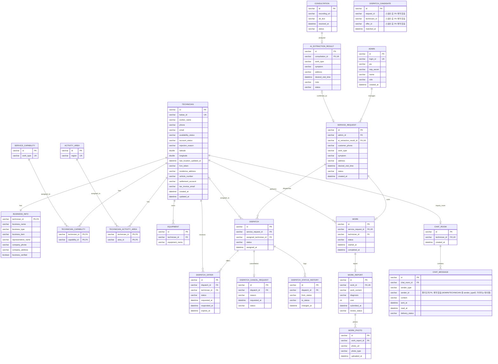

# ERD 초안

> [클래스 다이어그램](classdiagram.md)을 기준으로 작성한 1차 ERD 초안입니다. mermaid `erDiagram` 문법이며, VS Code "Markdown Preview Mermaid Support" 확장(`Ctrl+Shift+V`) 또는 https://mermaid.live 에서 미리볼 수 있습니다.
> `DispatchMatchingService`는 영속 데이터를 갖지 않는 서비스 클래스라 테이블로 옮기지 않았습니다.

---

## ERD 전환 시 내린 결정 (classdiagram.md에는 반영하지 않은, ERD 전용 결정)

이전 대화에서 정리한 3~7번 항목을 실제 테이블 설계로 반영한 내용입니다. 클래스 다이어그램 자체는 건드리지 않았습니다.

### `TECHNICIAN_CAPABILITY` / `TECHNICIAN_ACTIVITY_AREA` 조인 테이블 신설
- `classdiagram.md`에서 `Technician "0..*" --> "0..*" ServiceCapability`로 고친 N:M 관계를 실제 RDB에서 구현하려면 조인 테이블이 필요해서 신설. `SERVICE_CAPABILITY`/`ACTIVITY_AREA`는 이제 순수 마스터(코드) 테이블.
- `EQUIPMENT`는 여전히 `Technician "1" --> "0..*"` 그대로라 조인 테이블 없이 `technician_id` FK만 사용.

### `DISPATCH_CANDIDATE`는 FK 제약을 걸지 않음
- `classdiagram.md`의 `<<log>>` 스테레오타입 설계 의도(불변 스냅샷) 그대로, `request_id`/`technician_id`/`offer_id`를 참조 무결성 제약이 없는 순수 값 컬럼으로 둠.
- `Technician.withdraw()`가 실제로 하드 삭제가 아니라 `accountStatus = 탈퇴`로 저장하는 소프트 삭제로 확정됐으므로(아래 `TECHNICIAN.account_status` 항목 참고), 이 컬럼들에 FK 제약을 추가하는 방향도 다시 검토할 수 있음(현재는 보류 유지).

### `TECHNICIAN.approval_status` → `account_status`로 확장 (탈퇴 상태 추가)
- `FR-13` 설계 고려사항이 "기사 계정 상태(승인 대기/활성/반려/**탈퇴**)"를 하나의 값 도메인으로 명시하고 있어, 기존 `approval_status`(3개 값)로는 탈퇴 상태를 표현할 수 없었음.
- `classdiagram.md`도 동일하게 `accountStatus`로 이름을 바꾸고 값 도메인에 `탈퇴`를 추가함. `withdraw()`는 레코드 삭제가 아니라 `account_status = 탈퇴`로의 상태 변경으로 구현.
- `UC-17` 사후조건("과거 작업·이력 데이터는 통계 목적으로 보존될 수 있다")과 일치 — 탈퇴 후에도 `WORK`/`WORK_REPORT`/`DISPATCH` 등 과거 데이터가 참조 무결성을 유지한 채 남아있어야 하므로 하드 삭제 금지.

### `CHAT_MESSAGE.sender_id`는 폴리모픽 FK
- 발신자가 `ADMIN` 또는 `TECHNICIAN` 둘 중 하나일 수 있어 단일 FK 제약을 걸 수 없음. `sender_type` 값(`ADMIN`/`TECHNICIAN`)으로 어느 테이블을 참조하는지 애플리케이션에서 판별.

### `BUSINESS_INFO`는 PK 공유 방식의 1:1
- `technician_id`를 별도 surrogate id 없이 PK이자 FK로 사용 — 기사 1명당 사업자 정보가 정확히 1건이라는 제약을 컬럼 자체로 보장.

### 상태 컬럼은 우선 단순 varchar 유지 (단, `DISPATCH`는 이력 테이블 추가)
- `SERVICE_REQUEST.status`, `DISPATCH_OFFER.status`, `WORK.status`, `WORK_REPORT.review_status` 등은 지금은 애플리케이션 레벨 enum/CHECK 제약으로 처리.
- `DISPATCH.status`만은 `DISPATCH_STATUS_HISTORY`(dispatch_id, from_status, to_status, changed_at)를 추가해 변경 이력을 남기도록 함.
  - *이유*: `FR-09` 설계 고려사항 "상태 변경 시각 및 변경 이력 저장", `FR-12` 설계 고려사항 "배차 이력을 덮어쓰지 않고 별도의 이력으로 관리"가 명시적 요구사항이라 "나중에 필요해지면 추가"로 미룰 사안이 아니었음. 특히 FR-12는 재배차 시 기존 배차·취소 이력을 유지해야 한다고 못박고 있어 `DISPATCH`가 우선순위가 가장 높음.
  - `SERVICE_REQUEST`/`WORK`도 동일한 요구(FR-09)의 대상이지만, 우선 가장 이력 추적 요구가 뚜렷한 `DISPATCH`부터 반영하고 나머지는 팀 논의 후 동일 패턴으로 확장.

### PK 전략 / 공통 컬럼
- 모든 PK는 `varchar` UUID로 통일한다고 가정(클래스 다이어그램의 `id : varchar`와 일치).
- `created_at`/`updated_at`은 우선 원래 클래스 다이어그램에 명시된 테이블에만 넣었고, 나머지 테이블은 팀 논의 후 일괄 추가 여부 결정.

### 다중성 표기가 느슨했던 부분 — `TECHNICIAN ↔ DISPATCH`
- `classdiagram.md`의 `Dispatch "1" --> "0..1" Technician : assignedTechnician`은 "이 배차의 담당 기사가 누구인가"만 표현할 뿐, "기사 한 명이 여러 배차에 이력상 반복 배정될 수 있다"는 반대 방향 다중성은 명시돼 있지 않았습니다.
- ERD에서는 실제 의미대로 `TECHNICIAN |o--o{ DISPATCH`(기사 1명 : 배차 0..*)로 반영했습니다. 다이어그램 문구는 그대로 두었으니 참고하세요.

---

## 아직 열려 있는 질문

- `SERVICE_REQUEST.admin_id`(관리자-의뢰 `manages` 관계)가 "이 의뢰를 등록/확정한 관리자"를 의미하는지, 아니면 모든 관리자가 모든 의뢰에 접근 가능하고 이 FK는 단순 이력용인지 확인 필요(`ChatRoom`에서 마스터/부 관리자 모두 접근 가능하도록 설계한 것과 같은 논의가 필요할 수 있음).
- `Equipment`가 마스터 목록인지 기사별 자유 입력인지 결론이 나면 `TECHNICIAN_EQUIPMENT` 조인 테이블 신설 여부 재검토.
- 인덱스 설계: 배차 매칭 쿼리(`filterByAvailability`, `filterByCapability`, `filterByActivityArea`, `filterByCurrentWorkload`)가 자주 조회할 `TECHNICIAN(availability_status, account_status)`, `TECHNICIAN(latitude, longitude)`, `TECHNICIAN_CAPABILITY(capability_id)`, `TECHNICIAN_ACTIVITY_AREA(area_id)`, `WORK(technician_id, status)`에 인덱스 추가 권장.
- `SERVICE_REQUEST`/`WORK`도 `DISPATCH_STATUS_HISTORY`와 같은 패턴의 이력 테이블이 필요한지 팀 논의 필요(FR-09가 두 상태 모두에 적용되는 요구사항이라서).
- `DISPATCH`의 동시 수락 방지(FR-08 "동일 작업에 여러 기사가 동시에 수락을 요청하더라도 한 명의 기사만 확정")를 위한 낙관적 락 `version` 컬럼 추가 여부 검토.
