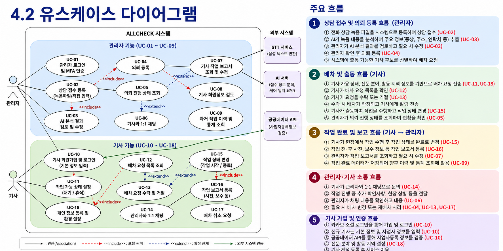

# 요구사항 분석

진행 상태: 진행 중
마감일: 2026년 10월 1일
프로젝트: 요구사항 분석 (https://app.notion.com/p/3dfd341168f6804e9e6cf235ce064e5c?pvs=21)
선행 작업: 2차 기획서 (https://app.notion.com/p/2-3d8d341168f680c794def4a6a3543354?pvs=21)
후속 작업: 프로토타입 (https://app.notion.com/p/3dfd341168f6803eb1ddffbcca6ba4a4?pvs=21)
관련 문서: 9/21 미팅 (https://app.notion.com/p/9-21-3dfd341168f680d3ae1ecd31c88f99d4?pvs=21)
관련 회의: 9/18 ( 기획 발표 피드백 & 요구사항 분석 논의 ) (https://app.notion.com/p/9-18-3dfd341168f680a39d8cfa6851cd1f89?pvs=21)

[AI*긴급설비*자동접수*배차*요구사항명세서*1-5*수정본.docx](assets/AI_%EA%B8%B4%EA%B8%89%EC%84%A4%EB%B9%84_%EC%9E%90%EB%8F%99%EC%A0%91%EC%88%98_%EB%B0%B0%EC%B0%A8_%EC%9A%94%EA%B5%AC%EC%82%AC%ED%95%AD%EB%AA%85%EC%84%B8%EC%84%9C_1-5_%EC%88%98%EC%A0%95%EB%B3%B8.docx)

- [ ] 파일명 : 6조*AI접수및배차*요구사항분석서\_김선우
- [ ] PPT 첫장 표지에 지도 교수님, 날짜 등 요소 추가
- [ ] 목차 항목 옆에 몇페이지인지도 적기

---

#### 저번 미팅 내용에서 고려 사항

- 주소 : 플레이스 태그 기반 동까지만 활용 , 세부 주소는 기사에게 토스로 생각. 셀핀랩은 STT 추출, 문자 텍스트 기반도 고민 중
- 광고 전화 거르기
- 기사 - 손님 간 통화 녹음 저장 고려

---

#### 로그인 및 인증 관련 정리 ( 지웅 )

- 대략적인 흐름

  ```kotlin
  ┌────────────────── 관리자 ──────────────────┐

  [계정 생성]
  공개 회원가입 ❌
          ↓
  셀핀랩 관리자 계정 사전 생성
          ↓
  관리자별 개별 ID/PW 발급
          ↓
  최초 로그인 시 TOTP MFA 등록
  (Google Authenticator 등)
          ↓
  관리자 계정 생성 완료

  [로그인 및 인증]
  ID/PW 로그인
          ↓
  1차 인증 성공
          ↓
  TOTP 6자리 MFA 추가 인증
          ↓
  최종 ADMIN 인증
          ↓
  ALLCHECK 자체 인증정보 발급
          ↓
  Access Token + Refresh Token
          ↓
  기사 모바일 앱 이용
          ↓
  이후 요청마다 JWT 기반 인증
          ↓
  /api/admin/** 접근

  [향후 확장]
  관리자 사전 생성
          ↓
  관리자 초대 기반 가입으로 확장 가능
  ```

  ```kotlin
  ┌─────────────────── 기사 ───────────────────┐

  [가입 / 로그인]
  카카오 로그인
          ↓
  카카오 OAuth/OIDC 인증
          ↓
  ALLCHECK Backend에서
  카카오 사용자 식별
          ↓
       최초 로그인 여부
         ↙          ↘
     기존 기사       신규 기사
        ↓               ↓
        │          기사 정보 등록
        │               ↓
        │          사업자 정보 입력
        │               ↓
        │          사업자 정보 검증
        │               ↓
        │        전문 분야 / 활동 지역 설정
        │               ↓
        │          기사 계정 생성
        │               ↓
        └───────┬───────┘
                ↓
        ALLCHECK 자체 인증정보 발급
                ↓
      Access Token + Refresh Token
                ↓
        기사 모바일 앱 이용
                ↓
      이후 요청마다 JWT 기반 인증
                ↓
        /api/technician/** 접근
  ```

- 관리자 사전 생성 근거
  > 이런 **폐쇄형 조직 사용자**에게는 공개 가입을 열지 않는 패턴이 자연스러워. B2B 인증 서비스인  ⁠Clerk도 작은 팀이고 구성원을 미리 알고 있거나 수동 승인이 필요한 경우에는 조직의 **Invitation 방식**이 적합하다고 설명하고, 초대한 사용자에게 특정 Role까지 지정할 수 있게 한다.    ⁠Auth0 역시 조직 관리 기능에서 관리자가 이메일로 구성원을 초대하고 역할을 부여하는 방식을 제공한다.
- 기사 카카오 로그인 근거
  - OAuth2.0 기반 소셜 로그인을 사용하면 개인정보 보호 의무의 일부 인증 관련 부담을 외부 IdP에 위임할 수 있다 ( 이메일 인증, 비밀번호 해시, 브루트포스 방어, 비밀번호 정책 … )
  - 이미 기사님들은 카카오 단체방에 있으니 카카오 계정이 있을 것이다. 그렇기에 카카오 소셜 로그인을 활용하기 적합하다 ( 굳이 다른 네이버, 구글 등의 소셜 로그인은 굳이..? )
  - 무엇보다 소셜 로그인쓰면 우리가 편하다
- JWT Stateless 인증 구조 선택 이유
  > **React 관리자 웹과 Flutter 기사 앱이 동일한 Spring Boot API 서버를 사용하므로, 인증 이후의 API 접근 방식을 JWT 기반 Token 인증으로 통일한다. 단, 사용 환경과 보안 요구 수준을 고려하여 관리자와 기사의 Refresh Token 유효기간 및 재인증 정책은 차등 적용한다.**

---

### ✅ 흐름도, 다이어그램 작성 관련 툴

- https://excalidraw.com/
- https://app.diagrams.net/
- https://www.google.com/aclk?sa=L&pf=1&ai=DChsSEwiN_4yfno6XAxVIbQ8CHZwpJEEYACICCAEQABoCdGI&co=1&ase=2&gclid=CjwKCAjw_eLVBhBEEiwAeaYZfEutHyrWXcGM9kamCKIonMlMomG1VIeon6geKv1RLi48E7-sMgNatBoCEtcQAvD_BwE&cid=CAASWeRo_l_11gR3EgbhCMuLqj5F3cwqOBp7Ft2g5VWtNA3l6DHLRu5sa9aW8VB-5spvxPwjdDJMMUbMoFale5oxVZJ9hxropos7Ugrztid9CWjuI4WFTlpeCrmJ&cce=2&category=acrcp_v1_32&sig=AOD64_0DjtpB9uHy2yxoKAwLO8Ou0tg9rg&q&nis=4&adurl=https://www.mermaid.ai/landing?utm_term%3Dmermaid%26utm_campaign%3Dmermaidecosystemfocus-G%26utm_content%3Dmermaid_broad%26utm_source%3Dgoogle_ads%26utm_medium%3Dprimary_search%26utm_term%3Dmermaid%26utm_campaign%3Dmermaidecosystemfocus-G%26utm_content%3Dmermaid_broad%26utm_source%3Dgoogle_ads%26utm_medium%3Dprimary_search%26gad_source%3D1%26gad_campaignid%3D21291684840%26gbraid%3D0AAAAAqtlhywYPZnfmFArOHPYerace30aX%26gclid%3DCjwKCAjw_eLVBhBEEiwAeaYZfEutHyrWXcGM9kamCKIonMlMomG1VIeon6geKv1RLi48E7-sMgNatBoCEtcQAvD_BwE&ved=2ahUKEwjJ9YWfno6XAxXTsVYBHW7fBf8Q0Qx6BAgZEAE

## 목차

## 프로젝트 개요

### 프로젝트명

> **AI 기반 긴급설비 자동접수 및 기사 배차 플랫폼**

### 프로젝트 목적

> 누수, 배관 막힘 등 긴급설비 작업의 전화 상담 이후 발생하는 **접수 정보 정리, 기사 탐색, 배차 요청, 작업 진행 상태 관리 등의 수작업을 자동화**하여 관리자의 반복 업무 부담을 줄이고 신속한 기사 배차가 이루어질 수 있도록 하는 것을 목적으로 한다.

## 문제설명서

### AS-IS & TO-BE

## AS-IS

> **상담 정보 수작업 정리**
>
> - 통화 후 증상·주소 등 직접 정리
> - 접수 업무가 관리자에게 집중

> **메신저 기반 기사 배차**
>
> - 단체방을 통한 출동 가능 여부 확인
> - 적합한 기사 탐색·선정 과정 수작업

> **업무 진행 상태 관리 어려움**
>
> - 배차·출동·작업 상태가 분산
> - 작업 결과 및 이력의 체계적 관리 부족

## TO-BE

> **AI 기반 접수 자동화**
>
> - STT 기반 상담 내용 변환
> - AI 기반 주요 접수 정보 자동 추출
> - 관리자 검토 후 의뢰 확정 ( Human-in-the-loop )

> **위치·작업 역량 기반 자동 배차**
>
> - 출동 가능한 적합 기사 후보 자동 선별
> - 푸시 알림 기반 배차 요청 및 수락

> 작업 관련 데이터 통합 관리
>
> - 배차·출동·작업 상태 실시간 관리
> - 작업 보고 및 이력 데이터 통합 관리

### 주요 기능

| 항목                            | 세부내용                                                                                                                         |
| ------------------------------- | -------------------------------------------------------------------------------------------------------------------------------- |
| **AI 기반 상담 접수**           | 전화 상담 녹음을 STT로 변환하고 AI가 **작업 유형·증상·주소·방문 희망시간** 등 주요 정보를 추출하여 관리자의 접수 업무를 지원     |
| **기사 후보 선별 및 자동 배차** | 의뢰의 **작업 유형, 기사 업무 가능 상태, 위치·활동 지역** 등을 기반으로 출동 가능한 기사 후보를 선별하고 배차 요청 전달          |
| **배차·작업 통합 관리**         | 관리자와 기사가 **배차 수락·출동·작업 진행 상태**를 공유하고, 의뢰별 채팅 및 작업 보고서를 통해 접수부터 작업 완료까지 통합 관리 |

### 기업 요구사항 반영 범위

| 요구사항                  | 요구 내용                                                 | 반영 여부        | 적용 범위 / 비고                                         |
| ------------------------- | --------------------------------------------------------- | ---------------- | -------------------------------------------------------- |
| 기존 전화 상담 유지       | 기존 전화 상담 방식 유지                                  | 반영             | 고객용 앱 없이 전화 접수 유지                            |
| 상담 내용 자동 정리       | 녹음 내용을 STT·AI로 분석                                 | 반영             | 주요 접수 정보 자동 추출                                 |
| 관리자 최종 검토          | AI 분석 결과 확인·수정                                    | 반영             | 관리자 검토 후 의뢰 확정                                 |
| 기사 전문 분야 관리       | 기사별 작업 가능 분야 관리                                | 반영             | 배차 후보 선정에 활용                                    |
| 위치, 역량 기반 기사 배차 | 고객에게 빨리 갈 수 있고, 작업을 처리할 수 있는 기사 배정 | 반영             | 위치·전문 분야 기반 후보 선정                            |
| 기사 업무 상태 관리       | 출동 가능 여부 관리                                       | 반영             | 업무 가능/불가능 상태 제공                               |
| 기사 자율 수락            | 기사가 배차 요청 수락·거절                                | 반영             | 수락 결과 기반 최종 배차                                 |
| 관리자-기사 대화          | 작업 관련 실시간 소통                                     | 반영             | 기사-관리자 문의 채팅 제공                               |
| 작업 상태 관리            | 출동부터 완료까지 상태 관리                               | 반영             | 작업 진행 현황 확인                                      |
| 작업 보고                 | 작업 내용 및 결과 기록                                    | 반영             | 사진·작업 내용·비용 등 등록                              |
| 고객 작업보고서           | 작업 결과를 고객에게 제공                                 | 부분 반영        | 보고서 생성 우선, 전달 방식 검토                         |
| 결제·가격 표준화          | 결제 및 작업 가격 관리                                    | 미반영(후속범위) | 향후 확장 기능                                           |
| 상담 원본 및 이력 관리    | 녹음·STT·접수 정보를 저장하고 조회                        | 반영             | 관리자 웹에서 녹음 및 상담 이력 조회                     |
| 관리자 모바일 접근        | 외부에서도 접수·배차 현황 확인                            | 반영             | PC·모바일 대응 반응형 웹 제공                            |
| 배차 실패·변경 대응       | 미수락·취소 등 배차 예외 상황 처리                        | 반영             | 재배차 및 관리자 개입 기능 제공                          |
| 데이터 기반 배차 고도화   | 축적된 작업 데이터를 활용한 기사 우선순위 적용            | 미반영(후속범위) | 작업 성공률·작업 이력 등을 활용하여 배차 알고리즘 고도화 |

## 업무 흐름도 ‼️

### 3-1 통합 흐름도

### 3-2 사용자 별 흐름도

**관리자**

1. 의뢰 올리기

ai 추출 확인-> 필요 시 수정 -> 의뢰 확정 -> 배차 현황 확인

1. 의뢰

확정된 의뢰를 조회, 수정, 취소한다.

1. 기사 문의

채팅방을 통해서 기사들의 문의를 처리한다.

1. 보고서

기사가 완료한 작업의뢰를 전송받아서 검토, 확정 -> 고객에게 전송

1. 프로필

관리자의 정보를 생성, 수정, 삭제, 조회한다.

---

**기사**

1. 계정 생성

소셜 로그인 → 필수, 선택 정보 입력 → 생성한다.

1. 배차 요청 수락

의뢰 클릭 -> 상세 확인 -> 수락/거절 -> 고객과 통화

1. 작업

작업 시작 -> 작업 종료 버튼 -> 보고서 작성하여 제출

1. 기사 프로필

기사 자신의 프로필을 수정, 조회, 삭제, 생성한다.

## 유스케이스

### 유스케이스 식별자 목록

### 관리자

| UC ID | 유스케이스명                  | 액터   |
| ----- | ----------------------------- | ------ |
| 1     | 관리자 로그인 및 MFA 인증     | 관리자 |
| 2     | AI 분석 결과 검토 및 수정     | 관리자 |
| 3     | 의뢰 등록                     | 관리자 |
| 4     | 의뢰 진행 상태 조회           | 관리자 |
| 5     | 기사 작업 보고서 조회 및 수정 | 관리자 |
| 6     | 기사 회원정보 검토 및 가입 승인 | 관리자 |
| 7     | 배차 취소 요청 검토 및 재배차 처리 | 관리자 |
| 8     | 과거 작업 이력 및 통계 조회   | 관리자 |

### 기사

| UC ID                                      | 유스케이스명                        | 액터 |
| ------------------------------------------ | ----------------------------------- | ---- |
| 9                                          | 기사 회원가입 및 로그인             |
| • 가입 시 기본 정보 입력                   | 기사                                |
| 10                                         | 작업 가능 상태 설정 ( 대기 / 휴식 ) | 기사 |
| 11                                         | 배차 요청 목록 조회                 | 기사 |
| 12                                         | 배차 요청 수락 및 거절              | 기사 |
| 13                                         | 작업 상태 변경 ( 작업 시작 / 종료 ) | 기사 |
| 14                                         | 작업 보고서 등록                    | 기사 |
| 15                                         | 배차 취소 요청                      | 기사 |
| 16                                         | 기사 개인 정보 등록 및 환경 설정    |
| • 전문 분야 및 활동 지역 설정 등 정보 수정 | 기사                                |
| 17                                         | 기사 계정 탈퇴                      | 기사 |

### 공통

| UC ID | 유스케이스명            | 액터         |
| ----- | ----------------------- | ------------ |
| 18    | 기사-관리자 간 1:1 채팅 | 관리자, 기사 |

- 이전 논의 내용
  **관리자**
  - 관리자 로그인
    - 관리자는 사전에 서버에 개발자가 등록해놓은 계정 정보를 기반으로 로그인을 할 수 있다. 이때 MFA를 통한 추가 인증을 통해 높은 권한을 가진 관리자의 계정을 보호한다.
    - JWT 기반 Stateless 방식을 채택한다
  - UC-01 녹음 파일 가져오기 또는 접수 내용 직접 입력
    - 지웅 : 녹음 파일 가져오기를 일반 흐름 , 수기 입력을 대안 흐름으로 분리할 수 있다 + 녹음 파일 가져오기 방식을 확정한 다음에 논의할 필요가 있을 것 같다**(데이터 디렉토리 등)**
  - UC-02 AI가 추출한 내용 검토·수정 ( 녹음 파일 및 접수 관련 정보 열람 )
    - AI 가 추출한 증상, 전화번호, 주소에서 틀린 점이 없는지 검토한다. 잘못된 정보가 있으면 웹/앱에서 관리자가 수정한다. **(반환 데이터 유형 등)**
  - UC-03 의뢰 등록
    - 고나리자가 어쩌거저쩌고해서 접수 버튼을 눌렀다
    - 시스템이 접수 정보와 기사의 현재 상태 및 정보를 고려하여 가용 기사를 선별한다
    - 시스템이 해당 기사들에게 접수 정보를 알림으로 전달한다
  - UC-04 의뢰 진행 상태 조회
    - 배정된 기사의 수락 여부와 작업 진행 상태를 확인한다. + 배정 기사, 접수 중 작업 진행 현황 …
  - 대화 확인
    - 필요한 경우 관리자와 기사 채팅으로 기사와 소통하고 재배차할 수 있다.
  - UC-05 기사 작업 보고서 확인
    - 전후 사진, 작업 보수, 증상, 주소, 전화번호를 DB에서 확인한다.
  - 과거 작업 데이터 통계 조회 ( 스프레드시트 등 외부 형식으로 내보내기 고려 )
  - 기사 회원정보 검토
    - 기사 가입 정보 및 사업자 정보를 확인한다.
      **기사**
  - UC-06 가입 및 사업자 정보 등록
    - 카카오 소셜 로그인을 통해 로그인을 진행한다.
    - 최초 로그인 계정(최초 가입)에 대해 근로자명, 사업체명, 업태, 종목, 대표자명, 전화번호, 이메일, 회사 대표번호, 회사 주소 등의 정보를 입력한다.
    - https://www.data.go.kr/data/15081808/openapi.do?recommendDataYn=Y&utm_source=chatgpt.com 를 통해 사업장 등록 여부를 검증한다.
    - JWT 기반 Stateless 방식을 채택한다
  - UC-07 전문 분야·활동 지역 설정
    - 배관막힘, 내벽누수, 외벽 누수 크게 3가지로 나누어 전문분야를 선택하게 하고 활동지역은 서울/경기 지역에서 동별로 나누어 설정한다.(다른지역 추가시 해당 지역도 동별로 나눔)
  - UC-08 의뢰 목록 확인
    - 기사는 배차 요청된 의뢰 목록과 주요 정보를 확인하고, 수락할 의뢰를 선택할 수 있다
  - UC-09 의뢰 수락
    - 내용을 확인하고 버튼을 눌러 의뢰를 수락한다.
  - UC- 11 관리자와 문의에 대한 채팅
    - 기사는 관리자에게 채팅을 통해 문의할 수 있다. 작업 진행 중 추가 확인사항이나 현장 상황 등을 전달하고 관리자의 안내를 확인할 수 있다.
  - UC-12 작업 상태 변경
    - 작업 시작, 완료 버튼을 눌러서 본인이 수락한 작업의 상태를 변경한다
  - 보고서 제출
    - 전후 사진과 받은 보수, 작업 관련 정보들을 앱에서 입력한다.
  - UC-13 의뢰 취소
  - 환경 설정 - 기사의 알림 설정, 개인 정보 수정 등
  - 작업 가능 여부 상태 변경
    - 기사 : 대기 / 휴식
  ***
  **AI 구성**
  - 시스템은 통화 녹음 파일을 STT를 이용하여 텍스트로 변환한다
  - AI는 상담 내용에서 증상, 주소, 연락처, 방문 희망 일정 및 특이사항을 추출한다.
  - AI는 추출한 정보를 정해진 형식으로 구조화하여 관리자 화면에 제공한다.
  - 관리자는 원본 녹음, STT 결과 및 AI 분석 결과를 비교하고 잘못된 정보를 수정한다.
  - 관리자는 검토·수정한 AI 접수정보를 최종 확정하여 배차에 사용할 수 있도록 한다.

### 유스케이스 다이어그램 ‼️

⭐ 대략적인 예시로 이거 기반 직접 그려서 완성하는 것이 좋을 것 같습니다



### 유스케이스 시나리오

## 관리자

### UC-01 관리자 로그인 및 MFA 인증

| 항목                                         | 내용                                                                                        |
| -------------------------------------------- | ------------------------------------------------------------------------------------------- |
| **행위자**                                   | 관리자                                                                                      |
| **유스케이스 내용**                          | 사전에 등록된 관리자 계정으로 로그인하고 MFA 추가 인증을 수행하여 관리자 시스템에 접근한다. |
| **사전 조건**                                | 1. 관리자 계정이 사전에 시스템에 등록되어 있어야 한다(마스터 관리자 또는 부 관리자, `role`로 구분).                                      |
| 2. 관리자 계정에 MFA가 설정되어 있어야 한다(최초 로그인 시에는 대안 흐름 A1을 따른다). |
| **기본 흐름**                                | 1. 관리자가 아이디와 비밀번호를 입력한다.                                                   |

2. 시스템이 입력된 계정 정보를 확인한다.
3. 시스템이 MFA 인증을 요청한다.
4. 관리자가 인증 앱에 표시된 인증 코드를 입력한다.
5. 시스템이 MFA 인증 코드를 검증한다.
6. 인증에 성공하면 관리자 로그인이 완료된다. |
   | **예외 흐름** | E1. 아이디 또는 비밀번호가 일치하지 않는 경우 → 시스템이 로그인 실패를 안내한다.
   E2. MFA 인증 코드가 올바르지 않은 경우 → 시스템이 인증 실패를 안내하고 재입력을 요청한다.
   E3. MFA 인증 코드의 유효시간이 만료된 경우 → 새로운 인증 코드 입력을 요청한다. |
   | **대안 흐름** | A1. 최초 로그인으로 계정에 MFA가 아직 설정되지 않은 경우 → 1차 인증(ID/PW) 성공 후 시스템이 TOTP 등록 절차(인증 앱 등록용 QR/시크릿 제공)를 안내하고, 관리자가 등록을 완료하면 이후 흐름을 계속 진행한다. |
   | **사후 조건** | 관리자가 인증된 상태가 되며 관리자 기능에 접근할 수 있다. 마스터/부 관리자 모두 이 절차로 인증되며, 역할(`role`)에 따른 세부 기능 접근 범위 차이는 별도 정책으로 확정되지 않아 현재는 두 역할 모두 동일한 관리자 기능에 접근한다. |

---

### UC-02 AI 분석 결과 검토 및 수정

| 항목                | 내용                                                                                           |
| ------------------- | ---------------------------------------------------------------------------------------------- |
| **행위자**          | 관리자                                                                                         |
| **유스케이스 내용** | 전화 상담 내용을 기반으로 AI가 추출한 주요 접수 정보를 관리자가 확인하고 필요한 경우 수정한다. |
| **사전 조건**       | 1. 관리자가 로그인되어 있어야 한다.                                                            |

2. 상담 접수가 등록되어 있어야 한다.
3. AI 분석 결과가 생성되어 있어야 한다. |
   | **기본 흐름** | 1. 관리자가 상담 접수 상세 화면을 조회한다.
4. 시스템이 상담 원본과 AI 분석 결과를 표시한다.
5. 관리자가 작업 유형, 증상, 주소, 방문 희망시간 등 추출된 정보를 확인한다.
6. 잘못 추출된 정보가 있는 경우 관리자가 해당 정보를 수정한다.
7. 관리자가 검토 완료를 선택한다.
8. 시스템이 최종 확인된 접수 정보를 저장한다. |
   | **예외 흐름** | E1. AI 분석에 실패한 경우 → 시스템이 분석 실패 상태를 표시하고 관리자가 직접 접수 정보를 입력할 수 있도록 한다.
   E2. 필수 접수 정보가 누락된 경우 → 시스템이 누락된 항목을 안내한다. |
   | **대안 흐름** | A1. AI가 추출한 정보가 모두 정확한 경우 → 관리자는 별도 수정 없이 검토를 완료한다. |
   | **사후 조건** | 관리자에 의해 확인된 접수 정보가 저장되며 의뢰 등록에 사용할 수 있다. |

---

### UC-03 의뢰 등록

| 항목                                                             | 내용                                                                                                 |
| ---------------------------------------------------------------- | ---------------------------------------------------------------------------------------------------- |
| **행위자**                                                       | 관리자                                                                                               |
| **유스케이스 내용**                                              | 관리자가 검토한 상담 접수 정보를 의뢰로 확정하고 시스템이 출동 가능한 기사에게 배차 요청을 전달한다. |
| **사전 조건**                                                    | 1. 관리자가 로그인되어 있어야 한다.                                                                  |
| 2. 접수에 필요한 정보에 대한 관리자 검토가 완료되어 있어야 한다. |
| **기본 흐름**                                                    | 1. 관리자가 최종 접수 정보를 확인한다.                                                               |

2. 관리자가 의뢰 등록을 선택한다.
3. 시스템이 의뢰를 생성한다.
4. 시스템이 작업 유형, 기사 작업 가능 상태, 전문 분야(외벽누수, 내벽누수, 막힘), 활동 지역 및 위치정보 등을 기반으로 출동 가능한 기사 후보를 선별한다
5. 시스템이 선별된 기사에게 배차 요청을 전달한다.
6. 시스템이 의뢰를 배차 진행 상태로 변경한다. |
   | **예외 흐름** | E1. 필수 접수 정보가 누락된 경우 → 시스템이 의뢰 등록을 제한하고 누락 정보를 안내한다.
   E2. 출동 가능한 기사가 없는 경우 → 시스템이 관리자에게 배차 가능한 기사가 없음을 안내한다.
   E3. 배차 요청 전달에 실패한 경우 → 시스템이 해당 상태를 기록하고 관리자에게 안내한다. |
   | **대안 흐름** | A1. 자동으로 적합한 기사 후보를 확보하지 못한 경우 → 관리자가 상황을 확인하고 후속 배차를 진행한다. |
   | **사후 조건** | 의뢰가 등록되고 출동 가능한 기사에 대한 배차 절차가 시작된다. |

---

### UC-04 의뢰 진행 상태 조회 ( 관리자가 배차 콜 날린 순간부터 완료 전까지인 작업의 상태 )

| 항목                                   | 내용                                                      |
| -------------------------------------- | --------------------------------------------------------- |
| **행위자**                             | 관리자                                                    |
| **유스케이스 내용**                    | 관리자가 등록된 의뢰의 배차 및 작업 진행 상태를 확인한다. |
| **사전 조건**                          | 1. 관리자가 로그인되어 있어야 한다.                       |
| 2. 조회할 의뢰가 등록되어 있어야 한다. |
| **기본 흐름**                          | 1. 관리자가 의뢰 목록을 조회한다.                         |

2. 시스템이 각 의뢰의 현재 상태를 표시한다.
3. 관리자가 특정 의뢰를 선택한다.
4. 시스템이 접수 정보, 배차 상태, 배정 기사 및 작업 진행 상태를 표시한다.
5. 관리자가 현재 진행 상황을 확인한다. |
   | **예외 흐름** | E1. 조회하려는 의뢰가 존재하지 않는 경우 → 시스템이 해당 의뢰를 찾을 수 없음을 안내한다. |
   | **대안 흐름** | A1. 관리자가 상태 또는 기간 등의 검색 조건을 지정하여 의뢰 목록을 조회한다. |
   | **사후 조건** | 의뢰 정보의 변경 없이 관리자가 현재 진행 상태를 확인한다. |

---

### UC-05 기사 작업 보고서 조회 및 수정

| 항목                                          | 내용                                                                            |
| --------------------------------------------- | ------------------------------------------------------------------------------- |
| **행위자**                                    | 관리자                                                                          |
| **유스케이스 내용**                           | 관리자가 기사가 제출한 작업 보고서와 작업 결과를 확인하고 필요한 경우 수정한다. |
| **사전 조건**                                 | 1. 관리자가 로그인되어 있어야 한다.                                             |
| 2. 기사가 작업 보고서를 등록한 상태여야 한다. |
| **기본 흐름**                                 | 1. 관리자가 작업 보고서 목록을 조회한다.                                        |

2. 관리자가 확인할 작업 보고서를 선택한다.
3. 시스템이 작업 전·후 사진, 작업 내용, 비용 등 보고서 정보를 표시한다.
4. 관리자가 작업 결과를 확인한다.
5. 필요한 경우 관리자가 수정 가능한 정보를 수정한다.
6. 시스템이 수정된 정보를 저장한다. |
   | **예외 흐름** | E1. 작업 보고서가 아직 등록되지 않은 경우 → 시스템이 미등록 상태를 표시한다.
   E2. 보고서 수정 또는 저장에 실패한 경우 → 시스템이 오류를 안내한다. |
   | **대안 흐름** | A1. 수정할 내용이 없는 경우 → 관리자는 조회만 수행하고 종료한다. |
   | **사후 조건** | 관리자가 작업 결과를 확인하며, 수정한 경우 변경된 보고서 정보가 저장된다. |

---

### UC-06 기사 회원정보 검토 및 가입 승인

| 항목                                     | 내용                                                                   |
| ---------------------------------------- | ---------------------------------------------------------------------- |
| **행위자**                               | 관리자                                                                 |
| **유스케이스 내용**                      | 관리자가 가입 신청한 기사의 기본 정보, 사업자 정보 및 활동 정보를 확인하고 최종 가입 승인 또는 반려를 결정한다. |
| **사전 조건**                            | 1. 관리자가 로그인되어 있어야 한다.                                    |
| 2. 승인 대기 상태의 기사 회원정보가 등록되어 있어야 한다. |
| **기본 흐름**                            | 1. 관리자가 승인 대기 상태를 포함한 기사 목록을 조회한다.                                      |

2. 관리자가 특정 기사를 선택한다.
3. 시스템이 기사의 기본 정보, 사업자 정보, 전문 분야, 활동 지역, 보유 장비 및 사업자 검증 결과를 표시한다.
4. 관리자가 등록된 정보를 확인한다.
5. 관리자가 가입 승인을 선택한다.
6. 시스템이 해당 기사 계정 상태를 '승인 대기'에서 '활성'으로 변경한다.
7. 시스템이 기사에게 가입 승인 결과를 알린다. |
   | **예외 흐름** | E1. 기사 정보가 누락된 경우 → 시스템이 미등록 또는 미완성 항목을 표시한다.<br>E2. 이미 승인 또는 반려 처리된 신청을 다시 처리하려는 경우 → 시스템이 재처리를 제한한다. |
   | **대안 흐름** | A1. 관리자가 이름, 사업체명 등의 조건으로 기사를 검색하여 조회한다.<br>A2. 관리자가 가입을 반려하는 경우 → 관리자가 반려 사유를 입력하고, 시스템이 계정 상태를 '반려'로 변경한 뒤 기사에게 반려 사유를 통보한다. |
   | **사후 조건** | 승인된 경우 기사 계정이 활성화되어 정상적으로 서비스를 이용할 수 있고, 반려된 경우 계정은 비활성 상태로 유지되며 기사에게 반려 사유가 통보된다. |

---

### UC-07 배차 취소 요청 검토 및 재배차 처리

| 항목                 | 내용                                                                                   |
| -------------------- | --------------------------------------------------------------------------------------- |
| **행위자**           | 관리자                                                                                   |
| **유스케이스 내용**  | 관리자가 기사가 제출한 배차 취소 요청을 검토하고 해당 의뢰에 대한 재배차를 진행한다.     |
| **사전 조건**        | 1. 관리자가 로그인되어 있어야 한다.<br>2. 기사가 제출한 배차 취소 요청(UC-15)이 존재해야 한다. |
| **기본 흐름**        | 1. 관리자가 배차 취소 요청 목록을 조회한다.<br>2. 관리자가 취소 사유와 의뢰 정보를 확인한다.<br>3. 관리자가 재배차를 진행하기로 결정한다.<br>4. 시스템이 기존 배차·취소 이력은 유지한 채 해당 의뢰를 재배차 대상 상태로 전환한다.<br>5. 시스템이 UC-04와 동일한 방식으로 출동 가능한 기사 후보를 다시 선별하여 배차 요청을 전달한다.<br>6. 관리자가 재배차 진행 상태를 확인한다. |
| **예외 흐름**        | E1. 재배차 가능한 기사 후보가 없는 경우 → 시스템이 관리자에게 안내하고 수동 처리를 요청한다.<br>E2. 이미 다른 방식으로 종료 처리된 취소 요청인 경우 → 시스템이 재배차 처리를 제한한다. |
| **대안 흐름**        | A1. 관리자가 재배차 대신 의뢰 자체를 취소하기로 결정하는 경우 → 시스템이 의뢰를 취소 상태로 종료한다. |
| **사후 조건**        | 재배차가 시작되면 새로운 배차 절차가 진행되고, 기존 취소 이력은 그대로 보존된다.         |

---

### UC-08 과거 작업 이력 및 통계 조회

| 항목                                                  | 내용                                                                                  |
| ----------------------------------------------------- | ------------------------------------------------------------------------------------- |
| **행위자**                                            | 관리자                                                                                |
| **유스케이스 내용**                                   | 관리자가 누적된 의뢰 및 작업 데이터를 조회하여 과거 작업 이력과 통계 정보를 확인한다. |
| **사전 조건**                                         | 1. 관리자가 로그인되어 있어야 한다.                                                   |
| 2. 시스템에 의뢰 및 작업 이력이 저장되어 있어야 한다. |
| **기본 흐름**                                         | 1. 관리자가 작업 이력 및 통계 화면에 진입한다.                                        |

2. 관리자가 조회 기간 및 조건을 설정한다.
3. 시스템이 조건에 해당하는 작업 데이터를 조회한다.
4. 시스템이 작업 이력 및 통계 정보를 표시한다.
5. 관리자가 결과를 확인한다. |
   | **예외 흐름** | E1. 조회 조건에 해당하는 데이터가 없는 경우 → 시스템이 조회 결과가 없음을 표시한다. |
   | **대안 흐름** | A1. 데이터 내보내기 기능을 제공하는 경우 → 관리자가 조회 결과를 스프레드시트 등의 외부 형식으로 내보낸다. |
   | **사후 조건** | 기존 데이터의 변경 없이 조회 결과가 관리자에게 제공된다. |

---

## 기사

### UC-09 기사 회원가입 및 로그인

| 항목                                       | 내용                                                                                                            |
| ------------------------------------------ | --------------------------------------------------------------------------------------------------------------- |
| **행위자**                                 | 기사                                                                                                            |
| **유스케이스 내용**                        | 기사가 카카오 소셜 로그인을 통해 인증하고, 최초 이용 시 기사 기본정보와 사업자 정보를 등록하여 가입을 신청한다. 가입 신청은 관리자의 최종 승인이 완료되어야 서비스를 이용할 수 있다. |
| **사전 조건**                              | 1. 기사가 카카오 계정을 보유하고 있어야 한다.                                                                   |
| 2. 서비스에 네트워크 연결이 가능해야 한다. |
| **기본 흐름**                              | 1. 기사가 카카오 로그인을 선택한다.                                                                             |

2. 카카오 인증을 통해 사용자 인증을 수행한다.
3. 시스템이 기존 기사 계정 존재 여부를 확인한다.
4. 신규 사용자인 경우 시스템이 기사정보 입력 화면을 제공한다.
5. 기사가 근로자명, 사업체명, 업태, 종목, 대표자명, 전화번호, 이메일, 회사 대표번호, 회사 주소, 세금계산서, 정산계좌, 기사 전문분야, 기사 거주지, 기사 활동지, 보유장비, 차량번호 정보를 입력한다.
6. 시스템이 외부 사업자등록정보 서비스를 통해 사업자 정보를 검증한다
7. 검증에 성공하면 시스템이 기사 계정을 '승인 대기' 상태로 등록하고 관리자에게 신규 가입 승인 요청을 알린다.
8. 시스템이 기사에게 "관리자 승인 대기 중" 상태를 안내하며, 승인 완료 전까지는 배차·채팅 등 주요 기능 이용을 제한한다.
9. 관리자가 가입 신청을 승인하면(UC-06) 시스템이 기사 계정 상태를 '활성'으로 전환하고 기사에게 승인 결과를 알린다.
10. 승인 완료 후 기사가 정상적으로 로그인하여 서비스를 이용할 수 있다. |
   | **예외 흐름** | E1. 카카오 인증에 실패한 경우 → 시스템이 로그인 실패를 안내한다.
   E2. 필수 회원정보가 누락된 경우 → 시스템이 누락 항목을 안내한다.
   E3. 입력한 사업자 정보가 유효하지 않은 경우 → 시스템이 입력 정보를 확인하도록 안내한다.
   E4. 외부 사업자등록정보 서비스에 장애가 발생한 경우 → 시스템이 현재 검증이 불가능함을 안내한다.
   E5. 관리자가 가입 신청을 반려한 경우 → 시스템이 계정 상태를 '반려'로 변경하고 기사에게 반려 사유를 안내한다. |
   | **대안 흐름** | A1. 기존 가입(승인 완료) 기사인 경우 → 회원정보 등록, 사업자 검증 및 관리자 승인 절차를 생략하고 바로 로그인한다.<br>A2. 승인 대기 중인 기사가 재로그인하는 경우 → 시스템이 현재 승인 대기 상태임을 다시 안내하고 서비스 이용은 계속 제한한다. |
   | **사후 조건** | 신규 회원의 경우 입력한 기사정보가 저장되고 계정은 '승인 대기' 상태가 되며, 관리자 승인이 완료된 이후에만 인증된 기사 계정으로 서비스에 정상 접근할 수 있다. |

---

### UC-10 작업 가능 상태 설정

| 항목                                            | 내용                                                                          |
| ----------------------------------------------- | ----------------------------------------------------------------------------- |
| **행위자**                                      | 기사                                                                          |
| **유스케이스 내용**                             | 기사가 현재 배차 요청을 받을 수 있는지 여부를 대기 또는 휴식 상태로 설정한다. |
| **사전 조건**                                   | 1. 기사가 로그인되어 있어야 한다.                                             |
| 2. 기사 계정이 정상적으로 등록되어 있어야 한다. |
| **기본 흐름**                                   | 1. 기사가 현재 작업 가능 상태를 확인한다.                                     |

2. 기사가 `대기` 상태를 선택한다.
3. 시스템이 기사의 상태를 작업 가능 상태로 변경한다.
4. 시스템은 해당 기사를 배차 가능한 기사 후보로 반영한다. |
   | **예외 흐름** | E1. 상태 변경에 실패한 경우 → 시스템이 오류를 안내하고 기존 상태를 유지한다. |
   | **대안 흐름** | A1. 기사가 `휴식` 상태를 선택하는 경우 → 시스템이 기사를 작업 불가능 상태로 변경하고 신규 배차 후보에서 제외한다. |
   | **사후 조건** | 기사의 최신 작업 가능 상태가 시스템에 저장되고 배차 후보 선정에 반영된다. |

---

### UC-11 배차 요청 목록 조회 및 수락

| 항목                | 내용                                                                    |
| ------------------- | ----------------------------------------------------------------------- |
| **행위자**          | 기사                                                                    |
| **유스케이스 내용** | 기사가 자신에게 전달된 배차 요청 목록과 각 의뢰의 주요 정보를 확인한다. |
| **사전 조건**       | 1. 기사가 로그인되어 있어야 한다.                                       |
| **기본 흐름**       |

1. 기사가 배차 요청 목록 화면에 진입한다.
2. 시스템이 기사에게 전달된 배차 요청 목록을 표시한다.
3. 기사가 특정 요청을 선택한다.
4. 시스템이 작업 유형, 증상, 위치, 방문 관련 정보 등 배차 판단에 필요한 정보를 표시한다.
5. 기사가 의뢰 내용을 확인한다.
6. 기사가 목록에서 본인이 수행할 수 있는 작업을 직접 선택하여 배차를 잡도록 시도할 수 있다. |
   | **예외 흐름** | E1. 유효한 배차 요청이 없는 경우 → 시스템이 현재 배차 요청이 없음을 표시한다.
   E2. 이미 다른 기사에게 배정되어 유효하지 않은 요청인 경우 → 시스템이 해당 요청이 종료되었음을 표시한다. |
   | **대안 흐름** | 없음 |
   | **사후 조건** | 배차 요청 정보가 기사에게 제공되고 기사는 수락 또는 거절 여부를 결정할 수 있다. |

---

### UC-12 배차 요청 수락 및 거절

| 항목                                                 | 내용                                                       |
| ---------------------------------------------------- | ---------------------------------------------------------- |
| **행위자**                                           | 기사                                                       |
| **유스케이스 내용**                                  | 기사가 전달받은 배차 요청을 확인한 후 수락하거나 거절한다. |
| **사전 조건**                                        | 1. 기사가 로그인되어 있어야 한다.                          |
| 2. 유효한 배차 요청이 기사에게 전달되어 있어야 한다. |
| **기본 흐름**                                        | 1. 배차 요청 알림이 전송된다. (ex)카카오택시)              |

2. 기사가 배차 요청 상세정보를 확인한다.
3. 기사가 `수락`을 선택한다.
4. 시스템이 해당 배차 요청의 유효성을 확인한다.
5. 시스템이 해당 기사를 의뢰의 담당 기사로 확정한다.
6. 시스템이 기사에게 배차 확정 결과를 표시한다.
7. 관리자 화면에 변경된 배차 상태가 반영된다. |
   | **예외 흐름** | E1. 다른 기사가 먼저 해당 의뢰를 수락한 경우 → 시스템이 해당 요청이 이미 마감되었음을 안내한다.
   E2. 배차 요청의 유효시간이 만료된 경우 → 시스템이 수락할 수 없음을 안내한다
   E3. 처리 중 오류가 발생한 경우 → 시스템이 수락 실패를 안내한다. |
   | **대안 흐름** | A1. 기사가 `거절`을 선택하는 경우 → 시스템이 거절 결과를 저장하고 해당 기사에 대한 배차 요청을 종료한다. |
   | **사후 조건** | 수락한 경우 담당 기사가 확정되며, 거절한 경우 해당 기사에 대한 배차 요청이 종료된다. |

---

### UC-13 작업 상태 변경

| 항목                                            | 내용                                                           |
| ----------------------------------------------- | -------------------------------------------------------------- |
| **행위자**                                      | 기사                                                           |
| **유스케이스 내용**                             | 배정된 기사가 실제 작업 진행 상황에 따라 작업 상태를 변경한다. |
| **사전 조건**                                   | 1. 기사가 로그인되어 있어야 한다.                              |
| 2. 기사에게 배정된 유효한 의뢰가 존재해야 한다. |
| **기본 흐름**                                   | 1. 기사가 배정된 의뢰를 조회한다.                              |

2. 현장 작업을 시작하면서 `작업 시작`을 선택한다.
3. 시스템이 해당 의뢰의 작업 상태를 진행 중으로 변경한다.
4. 작업을 마친 후 기사가 `작업 완료`를 선택한다.
5. 시스템이 해당 의뢰의 작업 상태를 완료로 변경한다.
6. 변경된 상태가 관리자에게도 반영된다. |
   | **예외 흐름** | E1. 기사에게 배정되지 않은 의뢰의 상태 변경을 요청한 경우 → 시스템이 요청을 거부한다.
   E2. 허용되지 않는 순서로 상태 변경을 요청한 경우 → 시스템이 변경을 제한한다.
   E3. 상태 변경 처리에 실패한 경우 → 시스템이 오류를 안내한다. |
   | **대안 흐름** | A1. 작업이 당일 완료되지 않고 추가 방문이 필요한 경우 → 시스템이 재방문이 필요한 상태로 처리한다. |
   | **사후 조건** | 최신 작업 진행 상태가 저장되고 관리자와 기사에게 반영된다. |

---

### UC-14 작업 보고서 등록

| 항목                                     | 내용                                                       |
| ---------------------------------------- | ---------------------------------------------------------- |
| **행위자**                               | 기사                                                       |
| **유스케이스 내용**                      | 기사가 수행한 작업의 내용과 결과를 작업 보고서로 등록한다. |
| **사전 조건**                            | 1. 기사가 로그인되어 있어야 한다.                          |
| 2. 기사에게 배정된 작업이 존재해야 한다. |
| **기본 흐름**                            | 1. 기사가 작업 보고서 작성 화면에 진입한다.                |

2. 기사가 작업 전·후 사진을 등록한다.
3. 기사가 작업 내용, 진단 결과, 작업 비용 등 필요한 정보를 입력한다.
4. 기사가 작업 보고서를 제출한다.
5. 시스템이 입력된 정보를 확인한다.
6. 시스템이 작업 보고서를 해당 의뢰에 연결하여 저장한다.
7. 등록된 작업 보고서를 관리자가 조회할 수 있는 상태로 변경한다. |
   | **예외 흐름** | E1. 필수 항목이 누락된 경우 → 시스템이 누락된 정보를 안내한다.
   E2. 사진 등록에 실패한 경우 → 시스템이 재등록을 요청한다.
   E3. 보고서 저장에 실패한 경우 → 시스템이 오류를 안내한다. |
   | **대안 흐름** | A1. 임시 저장 기능을 제공하는 경우 → 기사가 작성 중인 보고서를 임시 저장하고 이후 작성을 계속한다. |
   | **사후 조건** | 작업 보고서가 해당 의뢰 및 작업 이력에 저장되고 관리자가 조회할 수 있다. |

---

### UC-15 배차 취소 요청

| 항목                                                             | 내용                                                                                       |
| ---------------------------------------------------------------- | ------------------------------------------------------------------------------------------ |
| **행위자**                                                       | 기사                                                                                       |
| **유스케이스 내용**                                              | 배차를 수락한 기사가 불가피한 사유로 해당 작업을 수행할 수 없는 경우 배차 취소를 요청한다. |
| **사전 조건**                                                    | 1. 기사가 로그인되어 있어야 한다.                                                          |
| 2. 해당 기사가 의뢰를 수락하여 담당 기사로 배정되어 있어야 한다. |
| **기본 흐름**                                                    | 1. 기사가 배정된 의뢰를 조회한다.                                                          |

2. 기사가 배차 취소 요청을 선택한다.
3. 시스템이 취소 사유 입력을 요청한다.
4. 기사가 취소 사유를 입력하고 요청을 제출한다.
5. 시스템이 배차 취소 요청을 저장한다.
6. 시스템이 관리자에게 배차 취소 상황을 표시한다.
7. 해당 의뢰는 재배차가 필요한 상태로 변경된다. |
   | **예외 흐름** | E1. 이미 취소되거나 종료된 의뢰인 경우 → 시스템이 취소 요청을 제한한다.
   E2. 취소 요청 처리에 실패한 경우 → 시스템이 오류를 안내한다. |
   | **대안 흐름** | A1. 취소 요청 전에 기사와 관리자가 UC-18의 1:1 채팅을 통해 상황을 확인할 수 있다. |
   | **사후 조건** | 배차 취소 요청이 기록되고 해당 의뢰가 관리자 확인 또는 재배차가 필요한 상태가 된다. |

---

### UC-16 기사 개인 정보 등록 및 환경 설정

| 항목                                 | 내용                                                                                                   |
| ------------------------------------ | ------------------------------------------------------------------------------------------------------ |
| **행위자**                           | 기사                                                                                                   |
| **유스케이스 내용**                  | 기사가 자신의 개인정보와 전문 분야, 활동 지역, 보유 장비 및 서비스 이용에 필요한 환경 설정을 등록하거나 수정한다. |
| **사전 조건**                        | 1. 기사가 로그인되어 있어야 한다.                                                                      |
| 2. 기사 계정이 등록되어 있어야 한다. |
| **기본 흐름**                        | 1. 기사가 개인정보 및 환경 설정 화면에 진입한다.                                                       |

2. 시스템이 현재 등록된 정보를 표시한다.
3. 기사가 수정할 정보를 선택한다.
4. 기사가 전문 분야, 활동 지역, 보유 장비, 연락처 등의 정보를 입력 또는 수정한다.
5. 기사가 변경사항을 저장한다.
6. 시스템이 입력된 정보를 확인하고 변경사항을 저장한다. |
   | **예외 흐름** | E1. 필수 정보가 누락된 경우 → 시스템이 누락 항목을 안내한다.
   E2. 올바르지 않은 형식의 정보가 입력된 경우 → 시스템이 수정을 요청한다
   E3. 정보 저장에 실패한 경우 → 시스템이 오류를 안내한다. |
   | **대안 흐름** | A1. 알림 설정 기능을 제공하는 경우 → 기사가 배차 요청 등의 알림 수신 여부를 설정한다. |
   | **사후 조건** | 변경된 기사 정보 및 환경 설정이 저장되고 전문 분야와 활동 지역 등 배차 관련 정보가 이후 배차에 반영된다. |

---

### UC-17 기사 계정 탈퇴

| 항목                 | 내용                                                                                       |
| -------------------- | -------------------------------------------------------------------------------------------- |
| **행위자**           | 기사                                                                                          |
| **유스케이스 내용**  | 기사가 더 이상 서비스를 이용하지 않을 경우 본인의 계정을 탈퇴 처리한다.                       |
| **사전 조건**        | 1. 기사가 로그인되어 있어야 한다.                                                             |
| **기본 흐름**        | 1. 기사가 개인 정보 및 환경 설정 화면에서 계정 탈퇴를 선택한다.<br>2. 시스템이 탈퇴 시 유의사항(진행 중인 작업이 있는 경우 탈퇴 불가 등)을 안내한다.<br>3. 기사가 탈퇴를 최종 확인한다.<br>4. 시스템이 기사 계정을 탈퇴 처리한다.<br>5. 시스템이 이후 로그인 및 배차 후보 선정에서 해당 기사를 제외한다. |
| **예외 흐름**        | E1. 진행 중인(배정된) 작업이 있는 경우 → 시스템이 탈퇴를 제한하고 사유를 안내한다.<br>E2. 탈퇴 처리 중 오류가 발생한 경우 → 시스템이 오류를 안내하고 계정을 유지한다. |
| **대안 흐름**        | 없음                                                                                           |
| **사후 조건**        | 기사 계정이 탈퇴 처리되며 이후 로그인 및 신규 배차 대상에서 제외된다. 단, 과거 작업·이력 데이터는 통계 목적으로 보존될 수 있다. |

---

## 공통

### UC-18 기사-관리자 간 1:1 채팅

| 항목                                                                    | 내용                                                                                                     |
| ----------------------------------------------------------------------- | -------------------------------------------------------------------------------------------------------- |
| **행위자**                                                              | 관리자, 기사                                                                                             |
| **유스케이스 내용**                                                     | 관리자와 기사가 기사별 1:1 채팅을 통해 배차, 작업 및 현장 상황 등에 필요한 정보를 지속적으로 주고받는다. |
| **사전 조건**                                                           | 1. 관리자 또는 기사가 로그인되어 있어야 한다.                                                            |
| 2. 관리자와 해당 기사 사이에 채팅이 가능한 관계가 형성되어 있어야 한다. |
| **기본 흐름**                                                           | 1. 관리자 또는 기사가 1:1 채팅 화면에 진입한다.                                                          |

2. 시스템이 기존 대화 내역을 표시한다.
3. 사용자가 메시지를 입력하고 전송한다.
4. 시스템이 메시지를 저장한다.
5. 시스템이 상대방에게 새로운 메시지를 전달한다.
6. 상대방이 메시지를 확인한다.
7. 관리자와 기사가 필요한 대화를 계속한다. |
   | **예외 흐름** | E1. 메시지 전송에 실패한 경우 → 시스템이 전송 실패 상태를 표시하고 재전송할 수 있도록 한다.
   E2. 네트워크 연결이 불안정한 경우 → 시스템이 연결 상태 또는 메시지 전송 실패를 안내한다. |
   | **대안 흐름** | A1. 상대방이 채팅 화면을 사용하고 있지 않은 경우 → 시스템이 새로운 메시지가 도착했음을 알림으로 전달한다. |
   | **사후 조건** | 송수신된 메시지가 대화 이력으로 저장되며 관리자와 기사가 이후 다시 확인할 수 있다. |

## 기능 요구사항

### UI / HW/ SW …

### 기사 앱 사용자 인터페이스 요구사항

| 항목       | 내용                                                                                                      |
| ---------- | --------------------------------------------------------------------------------------------------------- |
| 플랫폼     | Android / iOS 기반 Flutter 모바일 앱                                                                      |
| 주요 화면  | 로그인·회원가입, 배차 요청 목록, 작업 상세, 작업 상태 변경, 작업 보고서, 1:1 채팅, 기사 정보 및 환경 설정 |
| 내비게이션 | 하단 탭 또는 메뉴 기반으로 주요 기능에 접근                                                               |
| 배차 요청  | 신규 배차 요청 발생 시 알림을 제공하고 앱에서 의뢰 상세정보 확인 및 수락·거절 가능                        |
| 작업 상태  | 배정된 작업에 대해 작업 시작·완료 등의 현재 상태를 직관적으로 변경 가능                                   |
| 위치정보   | 기사가 작업 가능 상태인 경우 위치정보 수집 상태 및 권한 상태를 확인할 수 있도록 구성                      |
| 채팅       | 관리자와 기사 간 지속적인 1:1 채팅 화면 제공                                                              |
| 작업 보고  | 작업 전·후 사진, 작업 내용, 비용 등의 입력 및 제출 인터페이스 제공                                        |
| 환경 설정  | 개인정보, 전문 분야, 활동 지역 및 알림 등 기사 설정 관리                                                  |

---

### 관리자 웹 사용자 인터페이스 요구사항

| 항목        | 내용                                                                                           |
| ----------- | ---------------------------------------------------------------------------------------------- |
| 플랫폼      | React 기반 웹 애플리케이션                                                                     |
| 지원 환경   | Chrome, Edge, Safari 등 주요 최신 웹 브라우저                                                  |
| 화면 구성   | 운영 현황을 확인할 수 있는 관리자 중심 화면 구성                                               |
| 상담 접수   | 상담 녹음 파일 및 접수 정보 등록 기능 제공                                                     |
| AI 분석     | STT 원문과 AI가 추출한 작업 유형·증상·주소·방문 희망시간 등을 확인하고 수정 가능               |
| 의뢰 관리   | 의뢰 등록 및 배차·출동·작업 진행 상태 조회                                                     |
| 기사 관리   | 기사 기본정보, 사업자 정보, 전문 분야, 활동 지역 및 작업 이력 조회                             |
| 작업 관리   | 기사가 제출한 작업 보고서 및 작업 이력 조회                                                    |
| 실시간 정보 | 배차 수락, 작업 상태 변경 및 채팅 등 실시간으로 변경되는 정보를 화면에 반영                    |
| 채팅        | 기사별 지속적인 1:1 채팅 화면 제공                                                             |
| 반응형      | PC 사용을 중심으로 구성하되 모바일 환경에서도 주요 관리 기능을 사용할 수 있도록 반응형 UI 지원 |

---

### 하드웨어 인터페이스 요구사항

| 항목                 | 활용 기능           | 세부 요구사항                                                                                                |
| -------------------- | ------------------- | ------------------------------------------------------------------------------------------------------------ |
| 스마트폰 위치 센서   | 기사 위치 기반 배차 | 기사 단말의 위치정보를 획득하여 서버로 전송하고 배차 후보 선정에 활용                                        |
| 백그라운드 위치 기능 | 기사 위치 지속 갱신 | 기사 앱이 화면에 표시되지 않는 상황에서도 OS 정책과 사용자 권한 범위 내에서 위치정보를 갱신할 수 있도록 구성 |
| 스마트폰 카메라      | 작업 보고서 작성    | 작업 전·후 현장 사진을 촬영하여 작업 보고서에 첨부                                                           |
| 사진 저장소          | 작업 보고서 작성    | 단말에 저장된 기존 작업 사진을 선택하여 보고서에 첨부 가능                                                   |
| 네트워크 인터페이스  | 서버 통신           | Wi-Fi 또는 이동통신망을 통해 REST API, WebSocket, FCM 등의 네트워크 통신 지원                                |

### 위치정보 인터페이스 세부 요구사항

- 기사가 `대기` 상태인 경우 배차를 위해 단말의 위치정보를 서버에 주기적으로 전달한다.
- 앱이 백그라운드 상태인 경우에도 OS가 허용하는 범위에서 위치정보 갱신을 지원한다.
- 기사가 `휴식` 상태로 변경하면 배차를 위한 지속적인 위치정보 수집을 중단한다.
- 위치 권한이 거부되거나 위치정보를 획득할 수 없는 경우 시스템은 해당 상태를 식별할 수 있어야 한다.
- 서버는 위치정보와 함께 마지막 위치 갱신 시각을 관리하여 오래된 위치정보를 구분할 수 있어야 한다.
- 위치정보 수집 주기는 정확도, 배터리 소모 및 네트워크 사용량을 고려하여 테스트 후 결정한다.

---

### 내부 시스템 인터페이스

| 인터페이스                | 통신 방식             | 주요 데이터 / 용도                                                                |
| ------------------------- | --------------------- | --------------------------------------------------------------------------------- |
| Flutter 기사 앱 ↔ Backend | HTTPS REST API        | 회원정보, 기사 상태, 위치정보, 배차 요청 조회·수락·거절, 작업 상태, 작업 보고서   |
| React 관리자 웹 ↔ Backend | HTTPS REST API        | 상담 접수, AI 분석 결과 확인·수정, 의뢰 등록, 기사 관리, 작업 보고서 및 이력 조회 |
| Client ↔ Backend          | WebSocket             | 관리자-기사 1:1 채팅 및 실시간 상태 전달                                          |
| Backend ↔ AI Service      | HTTPS REST API / JSON | STT 결과 분석 요청, 작업 유형·증상·주소·방문 희망시간 등 구조화 결과 전달         |
| Backend ↔ PostgreSQL      | JPA / JDBC            | 회원, 의뢰, 배차, 작업, 보고서, 채팅 및 이력 데이터 영속화                        |
| Backend ↔ Redis           | Redis Client          | Refresh Token, 일시적 상태 및 실시간성 데이터 관리에 선택적으로 활용              |
| Client → Backend          | Multipart/form-data   | 녹음 파일 및 작업 보고서 사진 업로드                                              |

기사 위치
Flutter ──주기적 REST──→ Backend

채팅
Flutter ←──WebSocket──→ Backend ←──WebSocket──→ React

배차 알림
Backend ──FCM──→ Flutter

---

### 외부 서비스 연동 인터페이스

| 외부 서비스              | 연관 기능                    | 인터페이스 요구사항                                                              |
| ------------------------ | ---------------------------- | -------------------------------------------------------------------------------- |
| STT API ( 미정 )         | 상담 녹음 음성 → 텍스트 변환 | Backend 또는 AI Service가 상담 녹음 파일을 전달하고 변환된 텍스트 결과를 수신    |
| LLM API ( 미정 )         | 상담 내용 구조화             | STT 결과를 분석하여 작업 유형, 증상, 주소, 방문 희망시간 등의 구조화된 결과 생성 |
| Kakao Login              | 기사 로그인                  | 카카오 인증을 통해 사용자를 식별하고 ALLCHECK 기사 계정과 연결                   |
| 사업자등록정보 API       | 기사 회원가입                | 기사 가입 시 입력한 사업자등록정보의 진위 및 상태 확인                           |
| Firebase Cloud Messaging | 기사 배차 알림               | Backend에서 기사 단말로 신규 배차 요청 등 Push Notification 전송                 |

### 기능 요구사항 명세

## FR-01 관리자 인증

| 항목                 | 내용                                                                                                                                                                                                                                                                                                                                       |
| -------------------- | ------------------------------------------------------------------------------------------------------------------------------------------------------------------------------------------------------------------------------------------------------------------------------------------------------------------------------------------ |
| **요구사항 ID**      | FR-01                                                                                                                                                                                                                                                                                                                                      |
| **요구사항 유형**    | 관리자                                                                                                                                                                                                                                                                                                                                     |
| **요구사항 명칭**    | 관리자 로그인 및 MFA 인증                                                                                                                                                                                                                                                                                                                  |
| **정의**             | 사전에 등록된 관리자만 ID/PW와 MFA 추가 인증을 통해 관리자 시스템에 접근할 수 있어야 한다.                                                                                                                                                                                                                                                 |
| **세부 내용**        | 1. 공개적인 관리자 회원가입 기능은 제공하지 않는다.<br>2. 관리자 계정은 마스터 관리자와 부 관리자로 구분되며(`role`), 사전에 등록된 ID/PW를 이용하여 1차 인증을 수행한다.<br>3. 계정에 MFA가 등록되어 있지 않은 최초 로그인의 경우, 1차 인증 성공 후 TOTP 등록 절차를 진행한다.<br>4. 1차 인증 성공 후 TOTP 기반 MFA 추가 인증을 수행한다.<br>5. MFA 인증이 완료된 경우에만 관리자 기능에 접근할 수 있도록 한다.<br>6. 로그인 실패 또는 MFA 인증 실패 시 관리자에게 인증 실패 결과를 제공한다. |
| **설계 시 고려사항** | Spring Security 기반 인증·인가 적용<br>Access Token 기반 API 인증<br>Refresh Token 관리 및 폐기 정책 적용<br>비밀번호는 단방향 해시하여 저장하고 TOTP Secret은 안전하게 보호<br>**(미결정)** 마스터/부 관리자 역할(`role`)별 기능·권한 차등 정책은 아직 확정되지 않음 — 현재는 두 역할 모두 동일 범위의 관리자 기능에 접근 가능한 것으로 간주하고, 정책이 확정되면 별도 FR/UC로 분리 예정 |
| **관련 유스케이스**  | UC-01 관리자 로그인 및 MFA 인증                                                                                                                                                                                                                                                                                                            |

---

## FR-02 상담 녹음 자동 수집 및 STT 변환

| 항목                 | 내용                                                                                                                                                                                                                                                                                                                                                                                                                                                                                            |
| -------------------- | ----------------------------------------------------------------------------------------------------------------------------------------------------------------------------------------------------------------------------------------------------------------------------------------------------------------------------------------------------------------------------------------------------------------------------------------------------------------------------------------------- |
| **요구사항 ID**      | FR-02                                                                                                                                                                                                                                                                                                                                                                                                                                                                                           |
| **요구사항 유형**    | 시스템                                                                                                                                                                                                                                                                                                                                                                                                                                                                                          |
| **요구사항 명칭**    | 상담 녹음 자동 수집 및 STT 변환                                                                                                                                                                                                                                                                                                                                                                                                                                                                 |
| **정의**             | 고객과 관리자의 전화 상담 종료 후 생성된 녹음 파일을 시스템이 자동으로 확보하고 STT를 통해 텍스트로 변환해야 한다.                                                                                                                                                                                                                                                                                                                                                                              |
| **세부 내용**        | 1. 전화 상담 종료 후 생성된 녹음 파일을 자동으로 확보할 수 있어야 한다.<br>2. 확보한 녹음 파일을 상담 건과 연결하여 저장할 수 있어야 한다.<br>3. 시스템은 녹음 파일을 STT 서비스에 전달하여 상담 내용을 텍스트로 변환해야 한다.<br>4. STT 변환 결과를 원본 녹음 파일과 함께 저장해야 한다.<br>5. 녹음 파일 확보 또는 STT 처리에 실패한 경우 실패 상태를 기록하고 관리자가 확인할 수 있어야 한다.<br>6. 자동 처리가 불가능한 경우 관리자가 접수 정보를 직접 입력할 수 있는 보완 수단을 제공한다. |
| **설계 시 고려사항** | 기존 070 전화 시스템의 녹음 파일 자동 확보 방법 확인 필요<br>STT 서비스 연동 방식 및 실제 녹음 품질에 대한 정확도 검증 필요<br>녹음 원본과 STT 결과의 연결 관계 유지                                                                                                                                                                                                                                                                                                                            |
| **관련 유스케이스**  | UC-03 AI 분석 결과 검토 및 수정의 선행 시스템 기능                                                                                                                                                                                                                                                                                                                                                                                                                                              |

---

## FR-03 AI 기반 상담 정보 추출

| 항목                 | 내용                                                                                                                                                                                                                                                                                                                                                                                                           |
| -------------------- | -------------------------------------------------------------------------------------------------------------------------------------------------------------------------------------------------------------------------------------------------------------------------------------------------------------------------------------------------------------------------------------------------------------- |
| **요구사항 ID**      | FR-03                                                                                                                                                                                                                                                                                                                                                                                                          |
| **요구사항 유형**    | 시스템 / AI                                                                                                                                                                                                                                                                                                                                                                                                    |
| **요구사항 명칭**    | AI 기반 상담 정보 분석 및 구조화                                                                                                                                                                                                                                                                                                                                                                               |
| **정의**             | STT로 변환된 상담 내용을 AI가 분석하여 서비스 접수 및 배차에 필요한 주요 정보를 구조화해야 한다.                                                                                                                                                                                                                                                                                                               |
| **세부 내용**        | 1. 시스템은 STT 결과를 AI 분석 대상으로 전달해야 한다.<br>2. AI는 상담 내용에서 작업 유형, 증상, 주소, 방문 희망 일정 및 특이사항 등의 정보를 추출해야 한다.<br>3. AI 분석 결과를 시스템이 처리 가능한 정해진 데이터 구조로 반환해야 한다.<br>4. AI 분석 결과와 STT 원문을 함께 관리자가 확인할 수 있도록 제공해야 한다.<br>5. AI 분석에 실패한 경우 실패 상태를 기록하고 관리자가 확인할 수 있도록 해야 한다. |
| **설계 시 고려사항** | AI Service와 Backend 간 API 인터페이스 정의<br>구조화된 JSON 형태의 분석 결과 사용<br>AI 분석 결과는 최종 확정 정보가 아닌 관리자 검토 대상으로 처리                                                                                                                                                                                                                                                           |
| **관련 유스케이스**  | UC-03 AI 분석 결과 검토 및 수정                                                                                                                                                                                                                                                                                                                                                                                |

---

## FR-04 AI 분석 결과 검토 및 수정

| 항목                 | 내용                                                                                                                                                                                                                                                                                                                                                                                                                                           |
| -------------------- | ---------------------------------------------------------------------------------------------------------------------------------------------------------------------------------------------------------------------------------------------------------------------------------------------------------------------------------------------------------------------------------------------------------------------------------------------- |
| **요구사항 ID**      | FR-04                                                                                                                                                                                                                                                                                                                                                                                                                                          |
| **요구사항 유형**    | 관리자                                                                                                                                                                                                                                                                                                                                                                                                                                         |
| **요구사항 명칭**    | AI 분석 결과 검토 및 수정                                                                                                                                                                                                                                                                                                                                                                                                                      |
| **정의**             | 관리자가 상담 녹음, STT 결과 및 AI가 추출한 접수 정보를 비교하고 잘못된 정보를 수정하여 최종 접수 정보를 확정할 수 있어야 한다.                                                                                                                                                                                                                                                                                                                |
| **세부 내용**        | 1. 관리자는 상담 녹음 원본을 확인할 수 있어야 한다.<br>2. 관리자는 STT로 변환된 상담 내용을 확인할 수 있어야 한다.<br>3. 관리자는 AI가 추출한 작업 유형, 증상, 주소, 방문 희망시간 등의 정보를 확인할 수 있어야 한다.<br>4. 잘못 추출되거나 누락된 정보를 관리자가 수정할 수 있어야 한다.<br>5. 관리자는 검토한 접수 정보를 최종 확정할 수 있어야 한다.<br>6. 시스템은 관리자가 최종 확정한 정보를 의뢰 등록에 사용할 수 있도록 저장해야 한다. |
| **설계 시 고려사항** | AI 원본 분석 결과와 관리자 수정 결과를 구분하여 관리하는 방안 고려<br>필수 접수정보에 대한 입력값 검증 적용                                                                                                                                                                                                                                                                                                                                    |
| **관련 유스케이스**  | UC-03 AI 분석 결과 검토 및 수정                                                                                                                                                                                                                                                                                                                                                                                                                |

---

## FR-05 의뢰 등록 및 기사 후보 선별

| 항목                 | 내용                                                                                                                                                                                                                                                                                                                                                                                                                                                   |
| -------------------- | ------------------------------------------------------------------------------------------------------------------------------------------------------------------------------------------------------------------------------------------------------------------------------------------------------------------------------------------------------------------------------------------------------------------------------------------------------ |
| **요구사항 ID**      | FR-05                                                                                                                                                                                                                                                                                                                                                                                                                                                  |
| **요구사항 유형**    | 관리자 / 시스템                                                                                                                                                                                                                                                                                                                                                                                                                                        |
| **요구사항 명칭**    | 의뢰 등록 및 배차 후보 선별                                                                                                                                                                                                                                                                                                                                                                                                                            |
| **정의**             | 관리자가 검토한 접수정보를 의뢰로 등록하면 시스템이 의뢰 조건과 기사 정보를 기반으로 출동 가능한 기사 후보를 선별해야 한다.                                                                                                                                                                                                                                                                                                                            |
| **세부 내용**        | 1. 관리자는 검토가 완료된 접수정보를 의뢰로 등록할 수 있어야 한다.<br>2. 시스템은 작업 유형과 기사의 전문 분야를 비교해야 한다.<br>3. 시스템은 기사의 작업 가능 상태를 확인해야 한다.<br>4. 시스템은 기사의 활동 지역 및 최신 위치정보를 배차 후보 선정에 활용해야 한다.<br>5. 배차 조건을 만족하는 기사 후보를 선별해야 한다.<br>6. 출동 가능한 기사가 없는 경우 관리자에게 해당 상태를 제공해야 한다.<br>7. 등록된 의뢰의 배차 상태를 관리해야 한다. |
| **설계 시 고려사항** | 작업 가능 상태·전문 분야·활동 지역·GPS 위치를 기반으로 후보 선별<br>향후 평점·작업 성공률·작업 이력 등을 활용한 배차 우선순위 고도화 가능하도록 데이터 축적                                                                                                                                                                                                                                                                                            |
| **관련 유스케이스**  | UC-04 의뢰 등록                                                                                                                                                                                                                                                                                                                                                                                                                                        |

---

## FR-06 기사 위치정보 수집 및 관리

| 항목                 | 내용                                                                                                                                                                                                                                                                                                                                                                                                                                                                                                                                                                                                   |
| -------------------- | ------------------------------------------------------------------------------------------------------------------------------------------------------------------------------------------------------------------------------------------------------------------------------------------------------------------------------------------------------------------------------------------------------------------------------------------------------------------------------------------------------------------------------------------------------------------------------------------------------ |
| **요구사항 ID**      | FR-06                                                                                                                                                                                                                                                                                                                                                                                                                                                                                                                                                                                                  |
| **요구사항 유형**    | 시스템 / 기사                                                                                                                                                                                                                                                                                                                                                                                                                                                                                                                                                                                          |
| **요구사항 명칭**    | 기사 GPS 위치정보 수집 및 관리                                                                                                                                                                                                                                                                                                                                                                                                                                                                                                                                                                         |
| **정의**             | 시스템은 작업 가능한 기사의 위치정보를 주기적으로 수집하여 배차 후보 선정에 활용할 수 있어야 한다.                                                                                                                                                                                                                                                                                                                                                                                                                                                                                                     |
| **세부 내용**        | 1. 기사 앱은 사용자의 위치정보 권한을 획득한 후 현재 위치를 수집할 수 있어야 한다.<br>2. 기사가 작업 가능 상태인 경우 위치정보를 서버에 주기적으로 전송할 수 있어야 한다.<br>3. 앱이 백그라운드 상태인 경우에도 OS 정책 및 사용자 권한 범위 내에서 위치정보 갱신을 지원해야 한다.<br>4. 서버는 기사의 최신 위치와 마지막 위치 갱신 시각을 관리해야 한다.<br>5. 오래된 위치정보를 최신 위치정보와 구분할 수 있어야 한다.<br>6. 기사가 휴식 상태인 경우 배차를 위한 지속적인 위치 수집을 중단할 수 있어야 한다.<br>7. 위치 권한이 없거나 위치정보를 획득하지 못한 상태를 시스템이 식별할 수 있어야 한다. |
| **설계 시 고려사항** | Android/iOS 백그라운드 위치 정책 준수<br>위치 갱신 주기는 정확도·배터리 소모·네트워크 사용량을 고려하여 테스트 후 결정<br>위치정보의 수집·보관 범위 및 접근권한 고려                                                                                                                                                                                                                                                                                                                                                                                                                                   |
| **관련 유스케이스**  | UC-04 의뢰 등록, UC-10 작업 가능 상태 설정                                                                                                                                                                                                                                                                                                                                                                                                                                                                                                                                                             |

---

## FR-07 배차 요청 및 알림

| 항목                 | 내용                                                                                                                                                                                                                                                                                                                                                                                                                      |
| -------------------- | ------------------------------------------------------------------------------------------------------------------------------------------------------------------------------------------------------------------------------------------------------------------------------------------------------------------------------------------------------------------------------------------------------------------------- |
| **요구사항 ID**      | FR-07                                                                                                                                                                                                                                                                                                                                                                                                                     |
| **요구사항 유형**    | 시스템 / 기사                                                                                                                                                                                                                                                                                                                                                                                                             |
| **요구사항 명칭**    | 배차 요청 전달 및 알림                                                                                                                                                                                                                                                                                                                                                                                                    |
| **정의**             | 시스템은 배차 후보로 선정된 기사에게 신규 배차 요청을 전달하고 기사가 이를 확인할 수 있도록 해야 한다.                                                                                                                                                                                                                                                                                                                    |
| **세부 내용**        | 1. 시스템은 선별된 기사에게 배차 요청을 생성해야 한다.<br>2. 기사에게 신규 배차 요청 발생 사실을 Push Notification으로 전달해야 한다.<br>3. 기사는 배차 요청 목록에서 자신에게 전달된 요청을 확인할 수 있어야 한다.<br>4. 기사는 작업 유형, 증상, 작업 위치 및 방문 관련 정보 등 배차 판단에 필요한 정보를 확인할 수 있어야 한다.<br>5. 이미 종료되거나 다른 기사에게 배정된 요청은 유효하지 않은 요청으로 처리해야 한다. |
| **설계 시 고려사항** | FCM 기반 Push Notification 활용<br>Push Notification 자체가 의뢰 데이터의 원본이 되지 않도록 하고 앱에서 서버의 최신 배차정보 조회                                                                                                                                                                                                                                                                                        |
| **관련 유스케이스**  | UC-04 의뢰 등록, UC-11 배차 요청 목록 조회                                                                                                                                                                                                                                                                                                                                                                                |

---

## FR-08 배차 요청 수락 및 거절

| 항목                                          | 내용                                                                                                                                                                                                                                                                                                                                                                                                                                                                                                                                                                                                                                                                                  |
| --------------------------------------------- | ------------------------------------------------------------------------------------------------------------------------------------------------------------------------------------------------------------------------------------------------------------------------------------------------------------------------------------------------------------------------------------------------------------------------------------------------------------------------------------------------------------------------------------------------------------------------------------------------------------------------------------------------------------------------------------- |
| **요구사항 ID**                               | FR-08                                                                                                                                                                                                                                                                                                                                                                                                                                                                                                                                                                                                                                                                                 |
| **요구사항 유형**                             | 기사 / 시스템                                                                                                                                                                                                                                                                                                                                                                                                                                                                                                                                                                                                                                                                         |
| **요구사항 명칭**                             | 배차 요청 수락·거절 및 미배정 작업 수락                                                                                                                                                                                                                                                                                                                                                                                                                                                                                                                                                                                                                                               |
| **정의**                                      | 기사는 자신에게 전달된 배차 요청을 수락 또는 거절할 수 있으며, 미배정 작업 목록에서 수행 가능한 작업을 직접 선택하여 수락할 수 있다. 시스템은 수락 결과에 따라 담당 기사를 확정해야 한다.                                                                                                                                                                                                                                                                                                                                                                                                                                                                                             |
| **세부 내용**                                 | 1. 기사는 자신에게 전달된 유효한 배차 요청을 수락 또는 거절할 수 있어야 한다.<br>2. 기사는 현재 담당 기사가 확정되지 않은 미배정 작업 목록을 조회할 수 있어야 한다.<br>3. 기사는 미배정 작업의 상세정보를 확인하고 수행 가능한 작업을 직접 선택하여 수락할 수 있어야 한다.<br>4. 시스템은 두 경로에서 수락 요청이 발생한 경우 해당 작업이 아직 배정 가능한 상태인지 확인해야 한다.<br>5. 동일 작업에 여러 기사가 동시에 수락을 요청하더라도 한 명의 기사만 담당 기사로 확정되어야 한다.<br>6. 담당 기사가 확정되면 해당 작업에 대한 다른 기사의 배차 요청을 종료하고 미배정 작업 목록에서도 제외해야 한다.<br>7. 시스템은 담당 기사 확정 결과를 해당 기사와 관리자에게 반영해야 한다. |
| **설계 시 고려사항**                          | 배차 요청을 통한 수락과 미배정 작업 직접 수락 모두 동일한 배차 확정 로직을 사용하도록 설계<br>동시 수락에 대한 원자적 처리 및 동시성 제어 필요<br>배차 요청·수락·거절·취소·재배차에 대한 상태 및 이력 관리 필요                                                                                                                                                                                                                                                                                                                                                                                                                                                                       |
| **관련 유스케이스**                           | UC-11 배차 요청 및 미배정 작업 목록 조회                                                                                                                                                                                                                                                                                                                                                                                                                                                                                                                                                                                                                                              |
| UC-12 배차 요청 수락·거절 및 미배정 작업 수락 |

---

## FR-09 의뢰 및 작업 진행 상태 관리

| 항목                 | 내용                                                                                                                                                                                                                                                                                                                                                                                                                                                                                                 |
| -------------------- | ---------------------------------------------------------------------------------------------------------------------------------------------------------------------------------------------------------------------------------------------------------------------------------------------------------------------------------------------------------------------------------------------------------------------------------------------------------------------------------------------------- |
| **요구사항 ID**      | FR-09                                                                                                                                                                                                                                                                                                                                                                                                                                                                                                |
| **요구사항 유형**    | 관리자 / 기사                                                                                                                                                                                                                                                                                                                                                                                                                                                                                        |
| **요구사항 명칭**    | 의뢰 및 작업 진행 상태 관리                                                                                                                                                                                                                                                                                                                                                                                                                                                                          |
| **정의**             | 관리자와 기사가 의뢰의 배차 및 작업 진행 상태를 확인하고, 기사가 작업 진행 상황에 따라 상태를 변경할 수 있어야 한다.                                                                                                                                                                                                                                                                                                                                                                                 |
| **세부 내용**        | 1. 관리자는 등록된 의뢰 목록과 현재 진행 상태를 조회할 수 있어야 한다.<br>2. 관리자는 배차 상태와 담당 기사를 확인할 수 있어야 한다.<br>3. 기사는 자신에게 배정된 의뢰의 작업 상태를 변경할 수 있어야 한다.<br>4. 시스템은 작업 시작·완료 등의 상태 변경을 저장해야 한다.<br>5. 기사에 의해 변경된 작업 상태를 관리자 화면에도 반영해야 한다.<br>6. 시스템은 허용되지 않는 순서의 상태 변경을 제한해야 한다.<br>7. 작업이 완료되지 않고 추가 방문이 필요한 경우 재방문 상태를 관리할 수 있어야 한다. |
| **설계 시 고려사항** | 의뢰 상태와 작업 상태의 명확한 상태 전이 정의<br>상태 변경 시각 및 변경 이력 저장<br>실시간 상태 반영 방식 적용                                                                                                                                                                                                                                                                                                                                                                                      |
| **관련 유스케이스**  | UC-05 의뢰 진행 상태 조회, UC-13 작업 상태 변경                                                                                                                                                                                                                                                                                                                                                                                                                                                      |

---

## FR-10 작업 가능 상태 관리

| 항목                 | 내용                                                                                                                                                                                                                                                                                                                    |
| -------------------- | ----------------------------------------------------------------------------------------------------------------------------------------------------------------------------------------------------------------------------------------------------------------------------------------------------------------------- |
| **요구사항 ID**      | FR-10                                                                                                                                                                                                                                                                                                                   |
| **요구사항 유형**    | 기사                                                                                                                                                                                                                                                                                                                    |
| **요구사항 명칭**    | 기사 작업 가능 상태 설정                                                                                                                                                                                                                                                                                                |
| **정의**             | 기사가 현재 신규 배차를 받을 수 있는지 여부를 대기 또는 휴식 상태로 설정할 수 있어야 한다.                                                                                                                                                                                                                              |
| **세부 내용**        | 1. 기사는 현재 작업 가능 상태를 확인할 수 있어야 한다.<br>2. 기사는 자신의 상태를 `대기` 또는 `휴식`으로 변경할 수 있어야 한다.<br>3. `대기` 상태의 기사는 배차 후보에 포함될 수 있어야 한다.<br>4. `휴식` 상태의 기사는 신규 배차 후보에서 제외되어야 한다.<br>5. 시스템은 기사의 최신 작업 가능 상태를 저장해야 한다. |
| **설계 시 고려사항** | 작업 가능 상태와 개별 의뢰의 작업 진행 상태를 별도의 상태로 관리                                                                                                                                                                                                                                                        |
| **관련 유스케이스**  | UC-10 작업 가능 상태 설정                                                                                                                                                                                                                                                                                               |

---

## FR-11 작업 보고서 등록 및 관리

| 항목                 | 내용                                                                                                                                                                                                                                                                                                                                                                                                                                                                     |
| -------------------- | ------------------------------------------------------------------------------------------------------------------------------------------------------------------------------------------------------------------------------------------------------------------------------------------------------------------------------------------------------------------------------------------------------------------------------------------------------------------------ |
| **요구사항 ID**      | FR-11                                                                                                                                                                                                                                                                                                                                                                                                                                                                    |
| **요구사항 유형**    | 기사 / 관리자                                                                                                                                                                                                                                                                                                                                                                                                                                                            |
| **요구사항 명칭**    | 작업 보고서 등록 및 관리                                                                                                                                                                                                                                                                                                                                                                                                                                                 |
| **정의**             | 기사가 수행한 작업의 내용과 결과를 보고서로 등록하고 관리자가 이를 조회 및 관리할 수 있어야 한다.                                                                                                                                                                                                                                                                                                                                                                        |
| **세부 내용**        | 1. 기사는 자신에게 배정된 작업에 대한 보고서를 작성할 수 있어야 한다.<br>2. 작업 전·후 사진을 등록할 수 있어야 한다.<br>3. 작업 내용, 진단 결과, 작업 비용 등의 정보를 입력할 수 있어야 한다.<br>4. 시스템은 보고서를 해당 의뢰 및 담당 기사와 연결하여 저장해야 한다.<br>5. 관리자는 기사가 제출한 작업 보고서를 조회할 수 있어야 한다.<br>6. 관리자는 권한이 허용된 보고서 정보를 수정할 수 있어야 한다.<br>7. 보고서 정보를 향후 작업 이력으로 활용할 수 있어야 한다. |
| **설계 시 고려사항** | 이미지 파일 저장소와 DB 메타데이터 분리 고려<br>작업 보고서 수정 권한 및 수정 이력 정책 정의 필요                                                                                                                                                                                                                                                                                                                                                                        |
| **관련 유스케이스**  | UC-06 기사 작업 보고서 조회 및 수정, UC-14 작업 보고서 등록                                                                                                                                                                                                                                                                                                                                                                                                              |

---

## FR-12 배차 취소 및 재배차 관리

| 항목                 | 내용                                                                                                                                                                                                                                                                                                                               |
| -------------------- | ---------------------------------------------------------------------------------------------------------------------------------------------------------------------------------------------------------------------------------------------------------------------------------------------------------------------------------- |
| **요구사항 ID**      | FR-12                                                                                                                                                                                                                                                                                                                              |
| **요구사항 유형**    | 기사 / 관리자 / 시스템                                                                                                                                                                                                                                                                                                             |
| **요구사항 명칭**    | 배차 취소 및 재배차 처리                                                                                                                                                                                                                                                                                                           |
| **정의**             | 담당 기사가 작업 수행이 어려운 경우 배차 취소를 요청할 수 있으며 시스템과 관리자는 해당 의뢰의 후속 배차를 처리할 수 있어야 한다.                                                                                                                                                                                                  |
| **세부 내용**        | 1. 담당 기사는 배차 취소를 요청할 수 있어야 한다.<br>2. 기사는 배차 취소 사유를 입력할 수 있어야 한다.<br>3. 시스템은 취소 요청과 사유를 저장해야 한다.<br>4. 관리자에게 배차 취소 상황을 제공해야 한다.<br>5. 취소된 의뢰를 재배차가 필요한 상태로 변경할 수 있어야 한다.<br>6. 관리자는 취소 요청을 검토하여 재배차를 진행하거나 의뢰 자체를 취소할 수 있어야 한다.<br>7. 재배차 시 기존 배차 및 취소 이력을 유지해야 한다. |
| **설계 시 고려사항** | 배차 이력을 덮어쓰지 않고 별도의 이력으로 관리<br>취소 이후 후보 재선정 및 관리자 개입 정책 정의                                                                                                                                                                                                                                   |
| **관련 유스케이스**  | UC-15 배차 취소 요청, UC-07 배차 취소 요청 검토 및 재배차 처리, UC-04 의뢰 등록                                                                                                                                                                                                                                                                                              |

---

## FR-13 기사 회원가입 및 인증

| 항목                 | 내용                                                                                                                                                                                                                                                                                                                                                                                                                                                                                              |
| -------------------- | ------------------------------------------------------------------------------------------------------------------------------------------------------------------------------------------------------------------------------------------------------------------------------------------------------------------------------------------------------------------------------------------------------------------------------------------------------------------------------------------------- |
| **요구사항 ID**      | FR-13                                                                                                                                                                                                                                                                                                                                                                                                                                                                                             |
| **요구사항 유형**    | 기사                                                                                                                                                                                                                                                                                                                                                                                                                                                                                              |
| **요구사항 명칭**    | 기사 회원가입 및 로그인                                                                                                                                                                                                                                                                                                                                                                                                                                                                           |
| **정의**             | 기사가 카카오 계정을 이용하여 인증하고 최초 이용 시 기사 및 사업자 정보를 등록하여 가입을 신청할 수 있어야 하며, 관리자의 최종 승인이 완료된 계정만 서비스를 이용할 수 있어야 한다.                                                                                                                                                                                                                                                                                                                                                                           |
| **세부 내용**        | 1. 카카오 소셜 로그인을 통한 기사 인증을 지원해야 한다.<br>2. 시스템은 카카오 인증 사용자와 기존 기사 계정의 연결 여부를 확인해야 한다.<br>3. 신규 기사는 기사 개인정보(근로자명, 전화번호, 이메일, 거주지, 차량번호, 정산계좌, 세금계산서 발행 이메일, 보유장비)와 사업자 정보(사업체명, 업태, 종목, 대표자명, 회사 대표번호, 회사 주소)를 등록할 수 있어야 한다.<br>4. 정산계좌·세금계산서 발행 이메일은 사업자(법인) 단위가 아닌 기사 개인 명의로 관리해야 한다.<br>5. 입력한 사업자 정보를 외부 사업자등록정보 서비스를 이용하여 검증해야 한다.<br>6. 사업자 검증 결과를 회원정보와 함께 관리해야 한다.<br>7. 사업자 검증이 완료된 신규 기사 계정은 '승인 대기' 상태로 등록되며, 관리자가 최종 승인해야 계정이 '활성' 상태로 전환되어 서비스를 이용할 수 있다.<br>8. 관리자가 가입 신청을 반려한 경우 계정은 '반려' 상태가 되며 반려 사유가 기사에게 통보되어야 한다.<br>9. 승인 대기 또는 반려 상태의 기사는 배차·채팅 등 주요 기능 이용이 제한되어야 한다.<br>10. 기존에 승인이 완료된 가입자는 추가 회원가입·승인 절차 없이 로그인할 수 있어야 한다.<br>11. 기사는 더 이상 서비스를 이용하지 않는 경우 본인 계정을 탈퇴할 수 있어야 한다. 단, 진행 중인 작업이 있는 경우 탈퇴를 제한해야 한다. |
| **설계 시 고려사항** | Kakao OAuth 기반 사용자 인증<br>국세청 사업자등록정보 진위확인 및 상태조회 API 연동<br>외부 API 장애와 실제 검증 실패를 구분하여 처리<br>기사 개인정보와 사업자 정보를 별도 엔티티로 분리하여 관리(계좌·세금계산서 이메일은 개인 소유)<br>기사 계정 상태(승인 대기/활성/반려/탈퇴) 값 및 상태별 기능 접근 제한 로직 설계 필요                                                                                                                                                                                                                                                                                                                                                             |
| **관련 유스케이스**  | UC-09 기사 회원가입 및 로그인, UC-06 기사 회원정보 검토 및 가입 승인, UC-17 기사 계정 탈퇴                                                                                                                                                                                                                                                                                                                                                                                                                                                     |

---

## FR-14 기사 정보 및 배차 조건 관리

| 항목                 | 내용                                                                                                                                                                                                                                                                                                                                                                                                                                             |
| -------------------- | ------------------------------------------------------------------------------------------------------------------------------------------------------------------------------------------------------------------------------------------------------------------------------------------------------------------------------------------------------------------------------------------------------------------------------------------------ |
| **요구사항 ID**      | FR-14                                                                                                                                                                                                                                                                                                                                                                                                                                            |
| **요구사항 유형**    | 기사 / 관리자                                                                                                                                                                                                                                                                                                                                                                                                                                    |
| **요구사항 명칭**    | 기사 개인정보·전문 분야·활동 지역·보유 장비 관리                                                                                                                                                                                                                                                                                                                                                                                                           |
| **정의**             | 기사가 개인정보와 배차에 필요한 전문 분야, 활동 지역, 보유 장비를 등록·수정하고 관리자가 해당 정보를 확인할 수 있어야 한다.                                                                                                                                                                                                                                                                                                                               |
| **세부 내용**        | 1. 기사는 자신의 개인정보를 조회 및 수정할 수 있어야 한다.<br>2. 기사는 배관 막힘, 내벽 누수, 외벽 누수 등의 전문 분야를 설정할 수 있어야 한다.<br>3. 기사는 자신의 활동 지역을 설정 및 변경할 수 있어야 한다.<br>4. 기사는 보유 장비를 등록·추가·삭제할 수 있어야 한다.<br>5. 시스템은 전문 분야, 활동 지역, 보유 장비를 배차 후보 선정에 활용해야 한다.<br>6. 관리자는 기사 기본정보, 사업자 정보, 전문 분야, 활동 지역 및 보유 장비를 확인할 수 있어야 한다.<br>7. 기사 앱의 알림 등 개인 환경 설정을 관리할 수 있어야 한다. |
| **설계 시 고려사항** | 전문 분야와 활동 지역을 배차 알고리즘에서 활용 가능한 구조로 관리<br>기사 개인정보와 운영용 배차정보의 접근권한 구분                                                                                                                                                                                                                                                                                                                             |
| **관련 유스케이스**  | UC-06 기사 회원정보 검토 및 가입 승인, UC-16 기사 개인 정보 등록 및 환경 설정                                                                                                                                                                                                                                                                                                                                                                                 |

---

## FR-15 관리자-기사 1:1 채팅

| 항목                 | 내용                                                                                                                                                                                                                                                                                                                                                                                                                                   |
| -------------------- | -------------------------------------------------------------------------------------------------------------------------------------------------------------------------------------------------------------------------------------------------------------------------------------------------------------------------------------------------------------------------------------------------------------------------------------- |
| **요구사항 ID**      | FR-15                                                                                                                                                                                                                                                                                                                                                                                                                                  |
| **요구사항 유형**    | 공통                                                                                                                                                                                                                                                                                                                                                                                                                                   |
| **요구사항 명칭**    | 관리자-기사 간 1:1 채팅                                                                                                                                                                                                                                                                                                                                                                                                                |
| **정의**             | 관리자와 기사가 배차, 작업 및 현장 상황 등에 필요한 정보를 기사별 1:1 채팅을 통해 실시간으로 주고받을 수 있어야 한다.                                                                                                                                                                                                                                                                                                                  |
| **세부 내용**        | 1. 기사별로 관리자와 지속적인 1:1 채팅을 제공해야 한다.<br>2. 관리자와 기사는 텍스트 메시지를 송수신할 수 있어야 한다.<br>3. 시스템은 채팅 메시지를 저장하고 기존 대화 내역을 조회할 수 있도록 해야 한다.<br>4. 새로운 메시지를 상대방에게 실시간으로 전달해야 한다.<br>5. 실시간 연결이 불가능한 경우 상대방이 새로운 메시지를 인지할 수 있도록 알림을 제공해야 한다.<br>6. 메시지 전송 실패 시 실패 상태를 사용자에게 제공해야 한다. |
| **설계 시 고려사항** | WebSocket 기반 실시간 양방향 통신<br>기사별 지속적인 채팅방 관리<br>비접속 사용자에 대한 Push Notification 연계 고려                                                                                                                                                                                                                                                                                                                   |
| **관련 유스케이스**  | UC-18 기사-관리자 간 1:1 채팅                                                                                                                                                                                                                                                                                                                                                                                                          |

---

## FR-16 작업 이력 및 통계 관리

| 항목                 | 내용                                                                                                                                                                                                                                                                                                                                                                                                                                                |
| -------------------- | --------------------------------------------------------------------------------------------------------------------------------------------------------------------------------------------------------------------------------------------------------------------------------------------------------------------------------------------------------------------------------------------------------------------------------------------------- |
| **요구사항 ID**      | FR-16                                                                                                                                                                                                                                                                                                                                                                                                                                               |
| **요구사항 유형**    | 관리자                                                                                                                                                                                                                                                                                                                                                                                                                                              |
| **요구사항 명칭**    | 과거 작업 이력 및 통계 조회                                                                                                                                                                                                                                                                                                                                                                                                                         |
| **정의**             | 관리자가 시스템에 축적된 의뢰·배차·작업 데이터를 조회하고 운영 및 향후 배차 고도화에 활용할 수 있어야 한다.                                                                                                                                                                                                                                                                                                                                         |
| **세부 내용**        | 1. 관리자는 과거 의뢰 및 작업 이력을 조회할 수 있어야 한다.<br>2. 기간, 기사, 작업 유형, 작업 상태 등의 조건을 이용하여 데이터를 조회할 수 있어야 한다.<br>3. 기사별 작업 수행 이력을 조회할 수 있어야 한다.<br>4. 작업 완료·취소·재방문 등 주요 결과 데이터를 누적 관리해야 한다.<br>5. 시스템은 축적된 데이터를 통계 형태로 제공할 수 있어야 한다.<br>6. 필요 시 조회 결과를 스프레드시트 등의 외부 형식으로 내보낼 수 있도록 확장 가능해야 한다. |
| **설계 시 고려사항** | 향후 평점·작업 성공률·작업 이력 등을 활용한 배차 우선순위 고도화가 가능하도록 데이터 구조 설계<br>통계 데이터와 운영 원본 데이터 구분 고려                                                                                                                                                                                                                                                                                                          |
| **관련 유스케이스**  | UC-08 과거 작업 이력 및 통계 조회                                                                                                                                                                                                                                                                                                                                                                                                                   |

## 클래스 다이어그램 ‼️

## 속성 정의 ( 애플리케이션 엔티티 필드 정의 ) ‼️

## 오퍼레이션 정의 ( 모듈 내 클래스 별 ) ‼️

## ERD & 테이블 정의서 ( DB 스키마 ) ‼️


## 시퀀스 다이어그램 ‼️

## 성능 평가 기준 ‼️

## 비기능 요구사항 명세 ‼️
